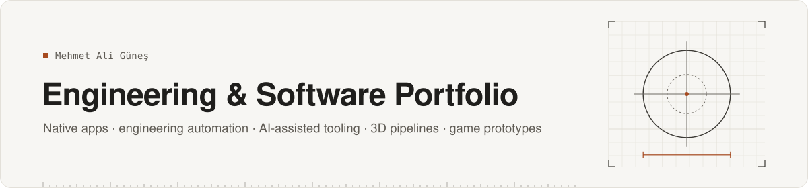
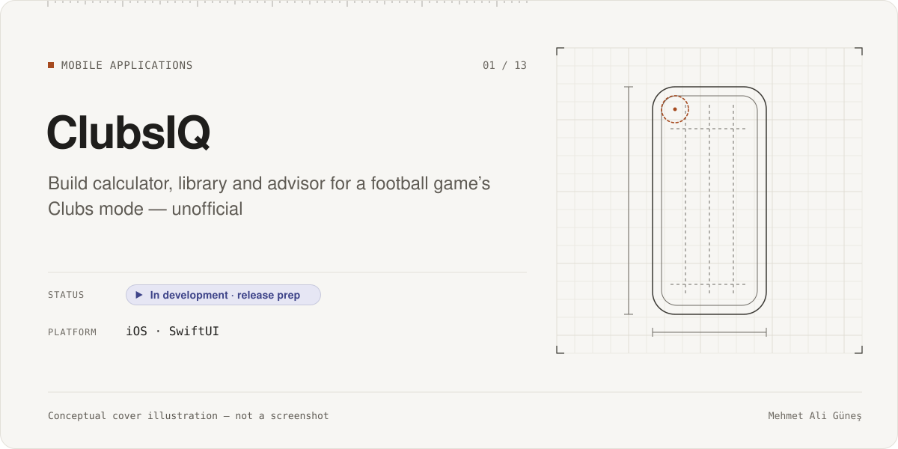
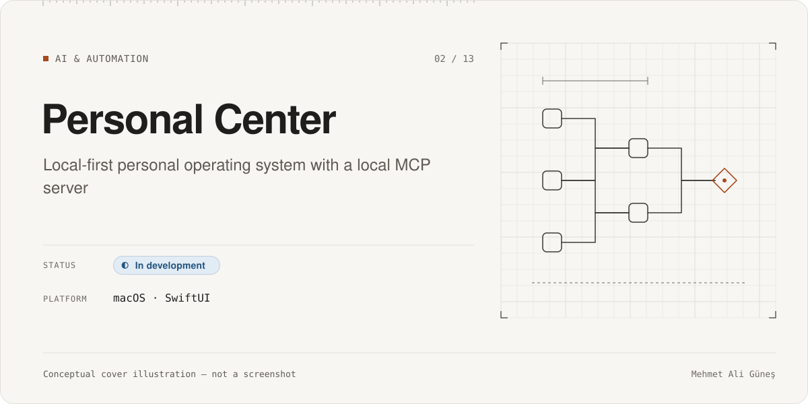
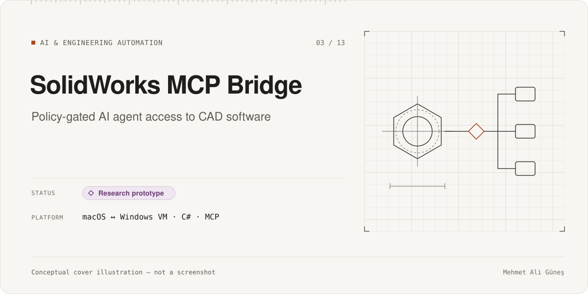
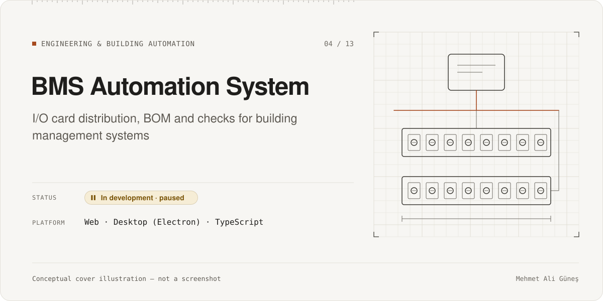
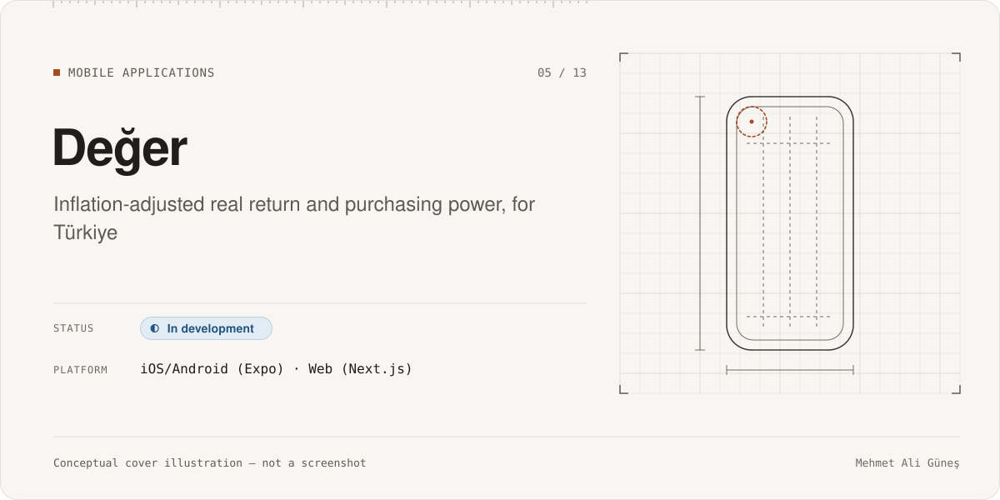
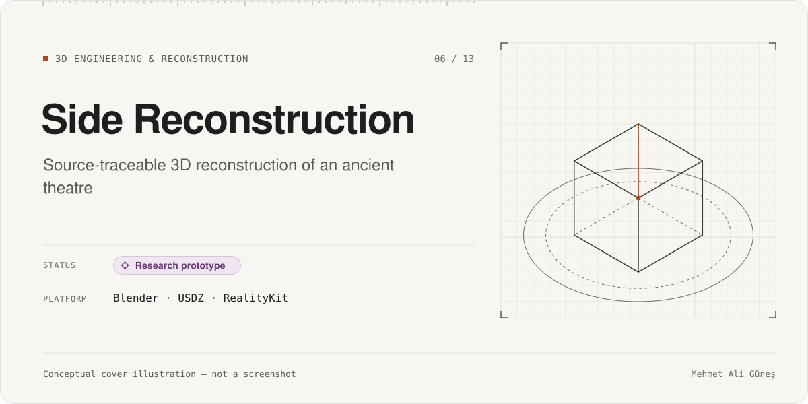

# Engineering & Software Portfolio

I'm **Mehmet Ali Güneş**, a Mechatronics Engineering student at Bahçeşehir University in Istanbul, Türkiye (B.Sc., expected graduation May 2027). This repository collects my engineering and software projects: native iOS/macOS apps, engineering and building automation, AI agent tooling built on the Model Context Protocol (MCP), 3D reconstruction pipelines, and game prototypes.

Most source code is private, either because it is ongoing product work or because it touches personal or client data. Each case study explains the problem, the architecture, my contributions, how the project was tested, and how far it has really progressed.

**Reading guide**
- Status labels are defined in [docs/status-legend.md](docs/status-legend.md). *Planned* features are never listed as *implemented*.
- Test numbers carry an evidence label: **RE-RUN** (re-executed on the stated date), **RECORDED** (from the project's own dated report), **STATIC** (counted from code), or **CI** (GitHub Actions record).
- I use **AI-assisted development**. [docs/ai-assisted-development.md](docs/ai-assisted-development.md) explains what I did myself and what AI agents did.
- [docs/what-is-not-public.md](docs/what-is-not-public.md) lists what this repository leaves out, and why.

---

## Featured projects

<table>
<tr>
<td width="50%" valign="top">

 <b><a href="projects/clubsiq/">ClubsIQ</a></b> · iOS 
Native build calculator, build library and deterministic build advisor for the Clubs mode of a football video game. Unofficial companion app, not affiliated with the game's publisher. 

</td>
<td width="50%" valign="top">

 <b><a href="projects/personal-center/">Personal Center</a></b> · macOS 
Local-first personal system. All writes go through one audited command layer. A local MCP server lets AI assistants connect without a network listener. 

</td>
</tr>
<tr>
<td width="50%" valign="top">

 <b><a href="projects/solidworks-mcp-bridge/">SolidWorks MCP Bridge</a></b> · macOS ↔ Windows VM 
A default-deny policy proxy between an AI coding agent and CAD software. It checks tools, paths and documents before any call reaches the CAD system. 

</td>
<td width="50%" valign="top">

 <b><a href="projects/bms-automation/">BMS Automation System</a></b> · Web · Desktop 
Turns building-management I/O point lists into router and I/O card distributions, BOMs and engineering checks. Includes a gated write-back to Excel and a DWG/DXF reader. 

</td>
</tr>
<tr>
<td width="50%" valign="top">

 <b><a href="projects/deger/">Değer</a></b> · iOS · Web 
Shows whether savings in Türkiye really gained purchasing power: nominal vs. inflation-adjusted returns from official data sources. Built on one canonical calculation engine. 

</td>
<td width="50%" valign="top">

 <b><a href="projects/side-reconstruction/">Side Reconstruction</a></b> · Blender · RealityKit 
Hypothetical 3D reconstruction of the Roman theatre at Side. Every mesh is traced to a source and carries an evidence class. 

</td>
</tr>
</table>

---

## All projects by category

### AI & Automation
| Project | Summary | Status | Main technologies |
|---|---|---|---|
| [Personal Center](projects/personal-center/) | Local-first macOS system with a local MCP server | In development | Swift, SwiftUI, SwiftData, MCP, n8n |
| [SolidWorks MCP Bridge](projects/solidworks-mcp-bridge/) | Policy-gated AI access to CAD | Research prototype | C# / .NET, MCP, Parallels, COM automation |
| [Agent Status Bar](projects/agent-status-bar/) | Status bar for multi-agent Claude Code sessions | Prototype | TypeScript, Claude Code plugin API |
| [Local AI Infrastructure & MCP Integrations](projects/local-ai-infrastructure/) | My local agent setup, MCP integrations and approval gates | In use · personal setup | MCP, Docker, n8n |

### Engineering & Building Automation
| Project | Summary | Status | Main technologies |
|---|---|---|---|
| [BMS Automation System](projects/bms-automation/) | I/O card distribution, BOM and checks for BMS | In development · paused | TypeScript, React, Electron, Excel |
| [SolidWorks MCP Bridge](projects/solidworks-mcp-bridge/) | CAD automation with safety policy | Research prototype | C# / .NET, MCP |

### Mobile Applications
| Project | Summary | Status | Main technologies |
|---|---|---|---|
| [ClubsIQ](projects/clubsiq/) | Build calculator, library and advisor (unofficial) | In development · release prep | Swift, SwiftUI, SwiftData, Swift Testing |
| [Değer](projects/deger/) | Real return and purchasing power, for Türkiye | In development | TypeScript, Expo, Next.js, Supabase |

### 3D Engineering & Reconstruction
| Project | Summary | Status | Main technologies |
|---|---|---|---|
| [Side Reconstruction](projects/side-reconstruction/) | Source-traceable reconstruction of an ancient theatre | Research prototype | Blender, USDZ, RealityKit, Swift |
| [ScanStudio](projects/scanstudio/) | Photogrammetry: photos to textured USDZ | In development | Swift, SwiftUI, Apple Object Capture |
| [Engineering Universe](projects/engineering-universe/) | Deterministic pipeline for interactive mechanical models | Research prototype | Parametric CAD, Blender, glTF/USDZ |

### Game Development
| Project | Summary | Status | Main technologies |
|---|---|---|---|
| [Swingline](projects/swingline/) | First-person grappling-hook speedrun | Prototype | Godot 4, GDScript |
| [Unreal Playground](projects/unreal-playground/) | Stylized asset pipeline and arena prototype | Early prototype | Unreal Engine 5 (Blueprints), Blender |

### Data & Excel Automation
| Project | Summary | Status | Main technologies |
|---|---|---|---|
| [Excel Data Automation](projects/excel-data-automation/) | Audit-trail data cleaning and formula-driven dashboards (synthetic data) | Completed samples | Microsoft Excel |

---

## How I work

- **Plan before code.** Each project has milestone plans, written decisions and explicit acceptance gates. Risky steps (real data, signing, releases, publishing) need a separate approval.
- **AI-assisted, human-directed.** I set requirements, architecture and acceptance criteria. AI coding agents implement much of the code. A separate AI reviewer (OpenAI Codex) reviews meaningful changes independently, and I accept or reject the result. Details: [docs/ai-assisted-development.md](docs/ai-assisted-development.md).
- **Evidence over claims.** Tests, recorded evidence and "not verified" lists are part of every milestone. Unfinished work is labeled as unfinished.

## Skills

| Used in my projects | Supporting, with AI assistance |
|---|---|
| Swift · SwiftUI · SwiftData · Swift Testing / XCTest | C# / .NET |
| TypeScript · React · Next.js · Expo / React Native | Python automation and generation scripts |
| Model Context Protocol (MCP) · AI coding agents | Unreal Engine Blueprints |
| GitHub Actions · Vitest / Jest | n8n · Docker |
| Blender · USDZ · RealityKit · Godot (GDScript) | |
| Microsoft Excel (formula-driven workbooks) | |

## Contact

- GitHub: [@maliguness](https://github.com/maliguness)
- LinkedIn: [mehmet-ali-gunes](https://www.linkedin.com/in/mehmet-ali-gunes/)

---

© Mehmet Ali Güneş. No open-source license is granted for the content of this repository. Product names are trademarks of their respective owners. These projects are independent and are not affiliated with or endorsed by those owners.
