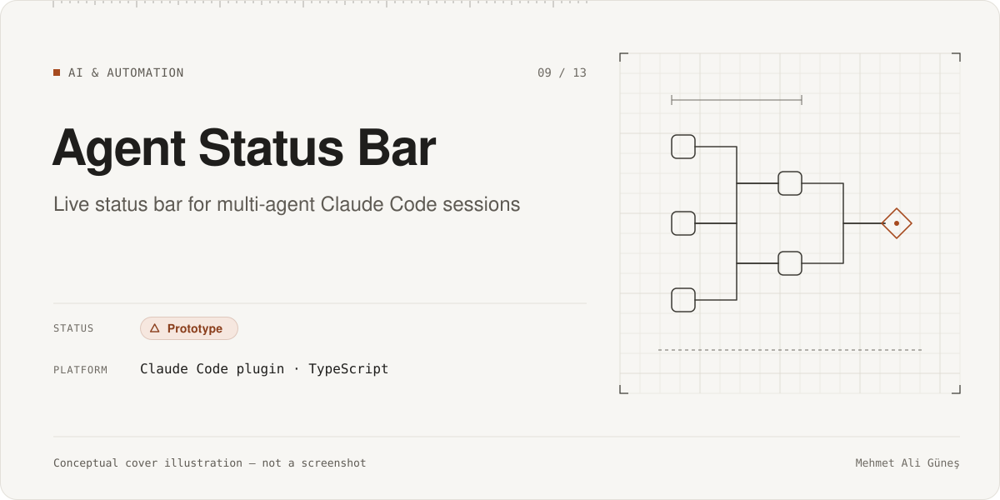
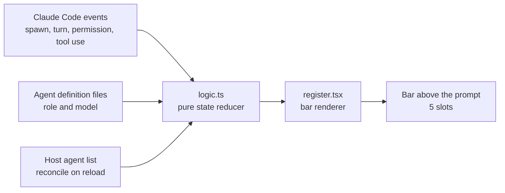

# Agent Status Bar

**Category:** AI & Automation · **Platform:** Claude Code plugin (desktop app Code tab and terminal) · **Period:** Nov 2026 · **Source code:** public (MIT) — [github.com/maliguness/agent-status-bar](https://github.com/maliguness/agent-status-bar)

> A small Claude Code mod that shows, in one compact bar above the prompt, what the orchestrating session and up to four subagents are doing: their task, role, model and status.

## Overview

When one Claude Code session delegates work to several subagents, it is hard to see at a glance who is running, on which model, and who is waiting for approval. Agent Status Bar draws a single horizontal bar above the prompt with five slots: the orchestrator plus up to four subagent runs. It only observes; it never starts agents or calls a model.

## Problem & Motivation

I run a role-based multi-agent workflow: planner, implementation and independent reviewer agents (see [Local AI Infrastructure](../local-ai-infrastructure/)). The default interface shows subagent activity in the transcript, but not as a live overview. I wanted a glanceable status line showing what is waiting on me, what is working, and which model each agent actually used.

## Solution

- The mod listens to Claude Code lifecycle events (agent spawn, turn start and completion, permission requests, tool use).
- A pure reducer turns those events into ordered slot state.
- A render module draws the bar.
- Roles and models are resolved from the spawn result, the reported model usage, and the agent definition files.
- On reload, the state is reconciled once against the host's agent list, so the bar does not show stale agents.

## Key Features

### Implemented
- Five slots: the orchestrator plus a cap of four subagent runs. Finished runs are ordered after working ones.
- Status per slot: Waiting, Working, Done, Error, Idle.
- Shows the configured model and the model actually used when they differ (including detection of an external reviewer CLI's model flag).
- Resets on `/clear`; a configurable role-label option.

### In progress
- Nothing scheduled; v0.1.0 is a single-commit release.

### Planned (not built)
- None documented.

## Technologies

TypeScript / TSX · Claude Code plugin and hooks API · unit tests for the reducer and rendering

## System Architecture

*Conceptual architecture diagram.*

## My Role & Contributions

- Identified the need from my own multi-agent workflow and defined the behavior.
- Defined the observe-only constraint and the slot and ordering rules.
- Tested the mod in daily use and published it as open source.

**AI-assisted development.** The product decisions, requirements, architecture choices, acceptance gates and verification were mine. Most of the code was written with AI coding agents (Claude Code) under my direction and review.

**Third-party components:** the Claude Code plugin API (host application). No other runtime dependencies.

## Testing & Validation

- One test file with about 16 tests covering the reducer and the bar (**STATIC**, 2026-11-10). They were not re-run for this page, and no CI is configured.
- About 1,100 lines of TypeScript/TSX including tests (**STATIC**).

## Current Development Status

**Prototype (v0.1.0).** It is public and usable, with one commit. There is no CI and no recorded test-run result.

## Screenshots / Visuals

The repository README contains a text mock-up of the bar. Planned visual: a cropped screenshot of the bar during a synthetic multi-agent run, with no project names or file paths visible.

---
Facts as of 2026-11-10. Evidence labels: RE-RUN = re-executed on that date; RECORDED = taken from the project's own dated report, not re-run; STATIC = file/code count; CI = GitHub Actions record. See ../../docs/status-legend.md.
