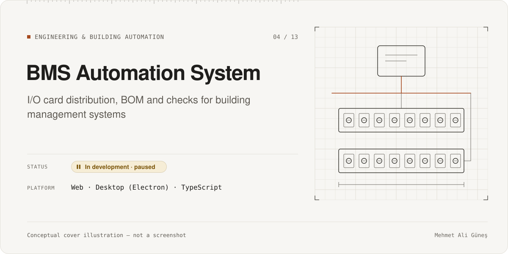
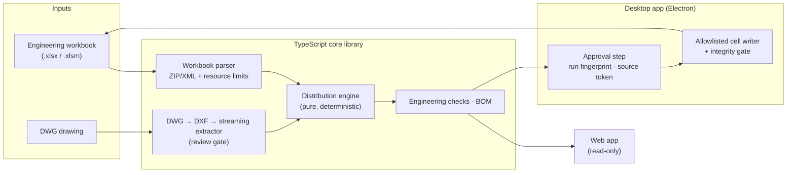

# BMS Automation System

**Category:** Engineering & Building Automation · **Platform:** TypeScript library · Web app · Desktop app (Electron, macOS/Windows) · **Period:** Aug – Sep 2026 (paused) · **Source code:** private

> Turns a building-management-system (BMS) point list into a physical I/O requirement, a router and I/O card distribution, a bill of materials and engineering checks. Results can be written back into the engineering workbook through a gated, verifiable write flow.

## Overview

In HVAC and building-automation projects, the field I/O list (digital and analog inputs and outputs, plus integration points) has to be turned into hardware:
- how many controllers and I/O cards are needed
- how the points are distributed across them
- what goes on the bill of materials.

This work is usually done by hand in large Excel workbooks.

The BMS Automation System automates that chain. It is a strict TypeScript core library with two front ends:
- a browser app that only reads the workbooks
- an Electron desktop app that can write results back into the project workbook through an approval-gated flow.

A DWG/DXF reader adds equipment information from drawings.

All examples and screenshots in this portfolio use **synthetic project data**. No customer data or project names are published.

## Problem & Motivation

- Manual I/O counting and card distribution is repetitive and error-prone. Small mistakes become hardware orders and wiring errors.
- The real workbooks contain macros, shared formulas and project-specific layouts. A tool that writes into them must never silently damage a file.
- Equipment information often lives in CAD drawings, not in the spreadsheet.

## Solution

- **Pure distribution engine.** Point counts and the router and card catalog go in; a deterministic card distribution comes out. Equivalent solutions are not chosen automatically.
- **Defensive workbook parsing.** XLSX and XLSM files are read directly from the ZIP/XML container, with limits on file size, entry count, decompressed size, rows and cells. This protects against oversized or malicious files. A browser-safe entry point contains no Node file-system code, and a test enforces that.
- **Gated write-back** (desktop):
  - Results are written only after an explicit approval step.
  - Each write is bound to a run fingerprint and a source token, and only allowlisted cells may change.
  - An integrity gate re-checks the workbook after writing.
- **Engineering checks and BOM** are generated from the same model as the distribution, so they cannot drift apart.
- **DWG/DXF path:** a DWG is converted to DXF (LibreDWG) and read by a streaming extractor, behind a review gate.

## Key Features

### Implemented
- Distribution engine and router/card catalog.
- Excel "Point Distribution" and point-list readers, with resource limits.
- Batch processing for multi-site workbooks.
- A read-only web app (React): processes `.xlsx` / `.xlsm` files entirely in the browser.
- An Electron desktop app (macOS and Windows builds, unsigned internal release):
  - project workspace and device library
  - point-list and equipment-list flows
  - gated write-back with an integrity gate.
- BOM generation and engineering checks.
- DWG/DXF reader with a streaming extractor (repository scope closed after review).

### In progress
- Windows Excel macro verification (a release gate).
- Template macro compatibility, and formal acceptance of the desktop end-to-end write flow.

### Planned (not built)
- Specification-driven checks (a separate phase, not started).
- Pricing and channel/terminal assignment. Both are explicitly out of scope today.

## Technologies

- **Core:** TypeScript (strict), Vitest, ESLint, Prettier; `fflate` for ZIP/XML
- **Web:** React 18, Vite, ExcelJS
- **Desktop:** Electron 33, React, Vite, electron-builder
- **CAD input:** LibreDWG (DWG → DXF), custom streaming DXF extractor
- Domain knowledge: HVAC/BMS point lists, I/O types, controller and I/O-card topology

## System Architecture

*Conceptual architecture diagram.*

## My Role & Contributions

- Domain knowledge and requirements: what a correct I/O distribution is, which workbook cells are safe to write, and which checks an engineer needs.
- Phase plan (19+ phases) with acceptance gates and manual GUI checks on macOS.
- Safety decisions: read-only web app, gated desktop writes, resource limits, and the review gate for drawings.

**AI-assisted development:**
- The TypeScript code and tests were written by AI coding agents under my phase plans.
- Each phase was reviewed by an independent AI reviewer, and I accepted it after manual checks.
- See [AI-assisted development](../../docs/ai-assisted-development.md).

## Testing & Validation

| Evidence | Scope | Result | Label |
|---|---|---|---|
| Full Vitest suite | Engine, parsers, batch, BOM, checks, DWG/DXF, web and desktop logic | 1,470 passed, 2 skipped | RECORDED 2026-09-15 |
| Architecture-boundary tests | E.g. no Node APIs in the browser entry point; DWG module boundaries | 49 / 49 | RECORDED 2026-09-15 |
| Desktop typecheck and build | Electron app | Pass | RECORDED 2026-09-15 |
| Manual GUI smoke tests (macOS) | Write flow v0 and DWG reader | Passed for the tested flows | RECORDED (dated per phase) |
| Test files | Core, web, desktop | ≈ 100 files | STATIC 2026-11-10 |

Some acceptance tests use real project files. They are gated by an environment variable and are **never** part of public material. Not verified: Windows Excel macro behaviour, and the full macro smoke test (only the "v0 write flow" smoke test passed).

## Current Development Status

**In development · paused** (since mid-September 2026).
- The core, web app, desktop app and DWG reader are implemented and tested.
- Release gates (Windows macro verification, formal acceptance) are open.
- No public or commercial release.

## Screenshots / Visuals

Planned visuals, using **synthetic project data only**:
1. Web app: distribution result for a fictional multi-site project
2. Desktop: approval step before write-back
3. BOM and engineering-check summary
4. The architecture diagram above

Facts as of 2026-11-10. Evidence labels: RE-RUN, RECORDED, STATIC, CI. See [status legend](../../docs/status-legend.md).
