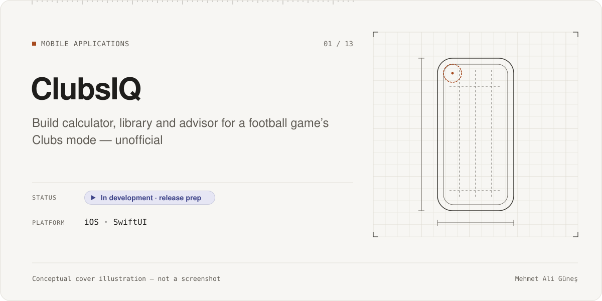
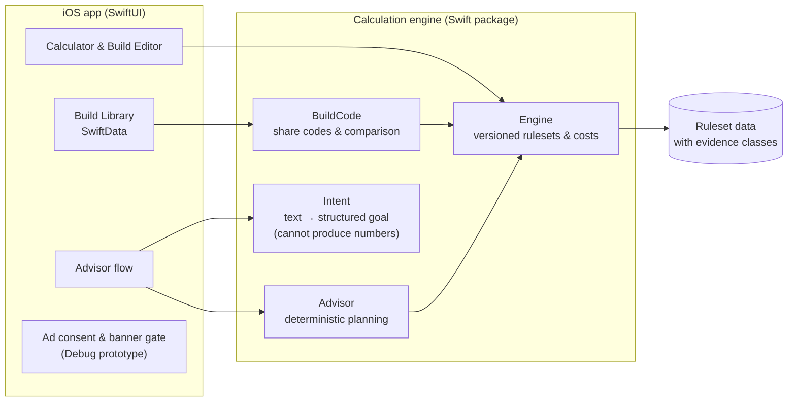
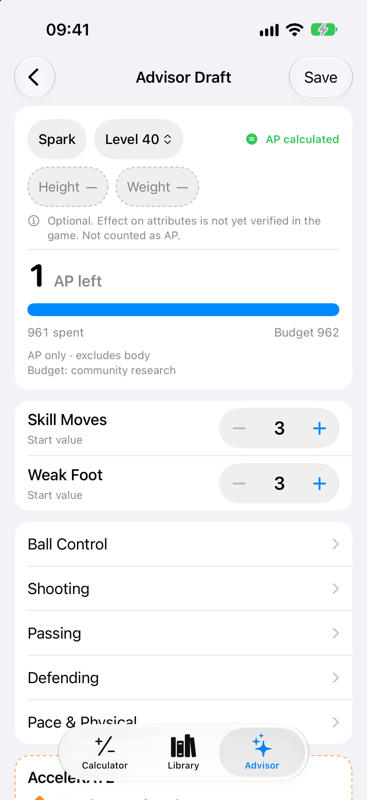
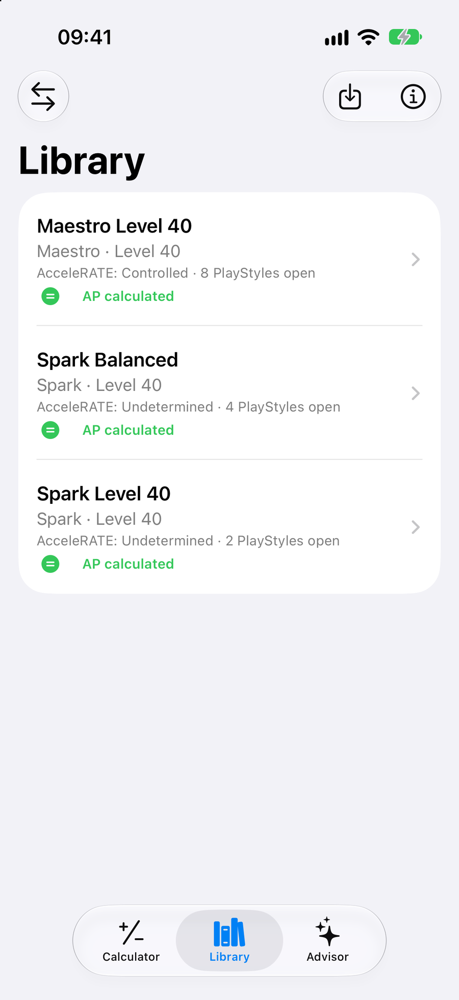
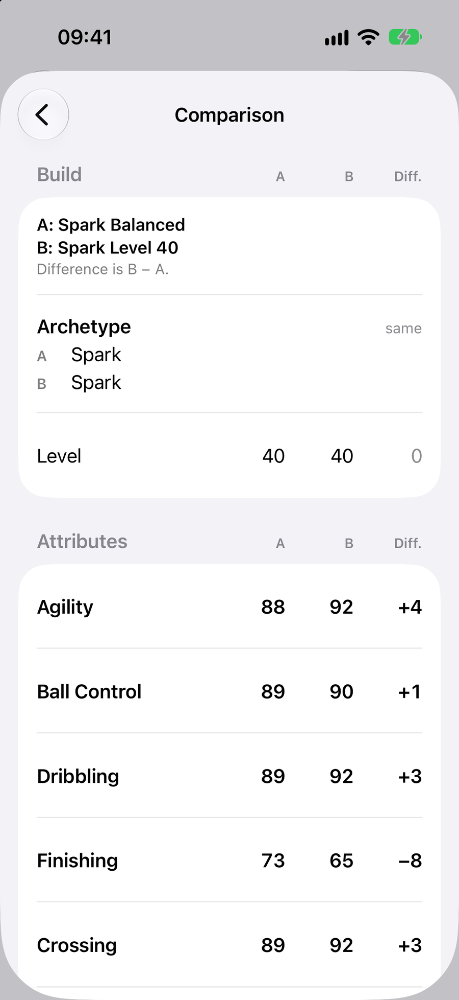
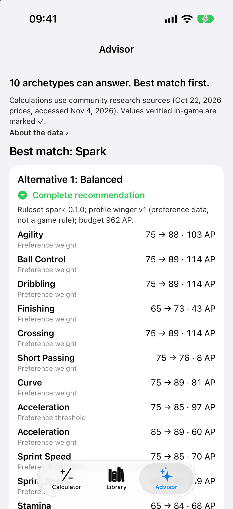
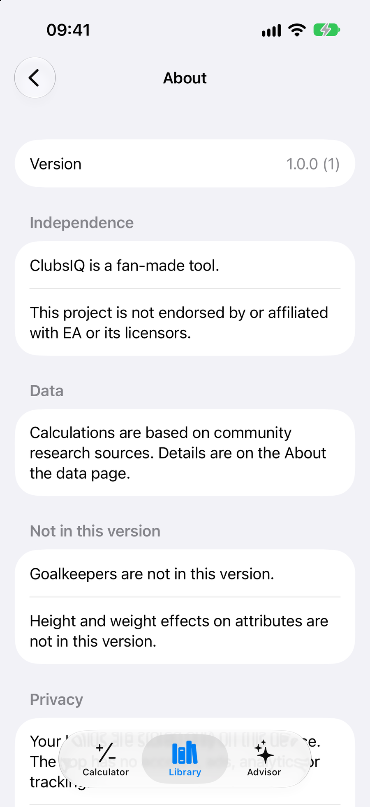
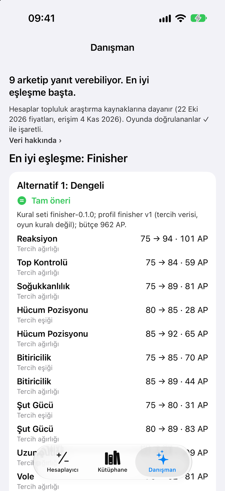

# ClubsIQ

**Category:** Mobile Applications · **Platform:** iOS (SwiftUI) · **Period:** Oct 2026 – present · **Source code:** private

> A native iOS app that calculates, stores, compares and plans player builds for the Clubs mode of a football video game. Every number comes from one deterministic, tested calculation engine.

## Overview

ClubsIQ, developed internally as *Clubs Companion*, is an **independent, unofficial companion app** for the Clubs mode of EA SPORTS FC™ 27. It is not affiliated with, endorsed by or connected to Electronic Arts. It uses no game assets and does not connect to the game.

The app has three modules:
- **Build Calculator:** edit a player build and see the attribute-point cost.
- **Build Library:** saved builds, share codes and comparison.
- **Build Advisor:** describe a goal in words and get a deterministic plan.

All three modules use the same Swift calculation engine.

The app is **not published in the App Store yet**. Work is currently focused on release readiness: legal and privacy texts, an ad-consent design, and final QA.

## Problem & Motivation

Players in Clubs mode spend a limited budget of attribute points across many attributes, archetypes and PlayStyles. Most of the data available about the costs comes from the community. It is incomplete and sometimes contradictory, and in-game menus do not make it easy to plan a build or compare two builds.

I wanted an app that:
- gives **exact, repeatable numbers** where the data is known
- says clearly where data is **inferred or conflicting**, instead of hiding it
- lets players **save, share and compare** builds offline, on device.

## Solution

- **One engine, many screens.** A separate Swift package owns all cost rules and calculations. The UI never calculates on its own.
- **Versioned rulesets with evidence classes.** Each data point has a provenance class:
  - *verified in game*
  - *verified from an official text*
  - *inferred*
  - *from community research*

  Research data can be used in production, but it is never labeled as game-verified. Conflicting data stays visibly marked as conflicting. For example, one archetype stays locked until its costs can be confirmed.
- **Deterministic advisor.** Natural-language input is first parsed into a structured intent. The parser cannot produce numbers; all costs come from the engine. The advisor never fills in steps it cannot price, and it reports the remaining points separately. Using an on-device LLM was evaluated and deliberately **deferred** (documented in an ADR).
- **Local-first library.** Builds are stored with SwiftData on the device. They can be shared through a compact, versioned share code or a share card image.

## Key Features

### Implemented
- Build Calculator and Build Editor: attribute steppers, an AP budget gauge, height/weight input, and per-value data-source labels.
- 10 of 11 field archetypes are selectable. One stays locked because the available cost data is conflicting.
- PlayStyles, PlayStyle+ and AcceleRATE in the build model (build schema v3, with migration from earlier versions).
- Build Library (SwiftData):
  - save, edit and delete
  - versioned share codes (import and export, with an import classification)
  - side-by-side comparison
  - share card image and Save to Photos
- Build Advisor: free-text goal composer with example chips, a confirmation step, results, and handoff to the editor. Covers levels 1–55, default level 40.
- English and Turkish localization; Dynamic Type and VoiceOver fixes from accessibility QA.
- Release preparation:
  - About and legal screens
  - an "independent app" disclaimer
  - a privacy manifest
  - privacy policy pages (EN/TR)
  - a final app icon.
- Ad-supported model, **Debug-only prototype**:
  - a consent and authorization policy (no ad request when consent is unknown, denied or in error)
  - fixed adaptive banners with a safe-reveal behaviour
  - a privacy-options and consent-recovery UI
  - a build-time gate that prevents demo ad IDs from reaching a store build.

### In progress
- Final QA for the first release (device checks, remaining screenshot evidence, a clean full UI-test run).
- Account, consent-platform and legal setup for the ad-supported release. The shipping gate for ads is **closed**.
- Regional launch plan: Türkiye first; EU only after its legal requirements are resolved.

### Planned (not built)
- Goalkeeper archetypes (deferred to 1.1).
- Height/weight effects on attributes. These stay a clearly labeled "community preview" until verified in game.
- CI for the iOS project (proposal written, not enabled).

## Technologies

- **Language & UI:** Swift, SwiftUI
- **Persistence:** SwiftData (on-device)
- **Engine:** local Swift package with four modules: Engine, BuildCode, Advisor, Intent
- **Testing:** Swift Testing, XCTest / XCUITest, golden and determinism tests
- **Project:** XcodeGen (`project.yml` as the single source); the String Catalog for EN/TR
- **Third-party SDKs (Debug prototype only, not shipping yet):** Google Mobile Ads and Google User Messaging Platform

## System Architecture

*Conceptual architecture diagram.*

Design rules:
- The UI only displays values the engine produced.
- The Intent module has no dependency on the Engine, so it cannot make up costs.
- Test-only launch flags exist only in Debug builds. Release builds cannot open the UI-test store.

## My Role & Contributions

- Product definition: scope per release, the evidence-class policy, and the decisions to lock conflicting data and to defer the LLM and goalkeepers.
- Architecture: separating the engine from the app, versioned rulesets and build schemas, the share-code format, and the deterministic advisor boundaries. These are recorded in 10 Architecture Decision Records (ADRs).
- Release planning: the privacy and legal approach, the ad-consent policy, and the regional launch strategy.
- QA policy ("automation first"): I check the parts automation cannot cover by hand on device and simulator, and I sign off each milestone.

**AI-assisted development:**
- Most of the Swift code and tests were written by AI coding agents (Claude Code) under my plans, acceptance criteria and review.
- An independent AI reviewer (OpenAI Codex) reviewed the milestones. One QA milestone was closed by my **explicit risk acceptance**, not by a reviewer pass; the missing evidence is listed in the project.
- See [AI-assisted development](../../docs/ai-assisted-development.md).

## Testing & Validation

| Suite | Scope | Result | Evidence |
|---|---|---|---|
| Engine tests (Swift Testing) | Costs, rulesets, share codes, comparison, intent parsing, advisor; including a 100× byte-identical determinism check for every profile and level | **512 / 512 passed** | **RE-RUN 2026-11-10** |
| App unit tests (Swift Testing / XCTest) | View models, persistence, localization, ad-consent policy, import/export | **333 / 333 passed** (iPhone 17 simulator, iOS 27, Debug) | **RE-RUN 2026-11-10** |
| App UI tests (XCUITest) | 121 test declarations | **Not run for this portfolio**; no pass claim | STATIC |

Notes:
- In the engine run, one test reports a *known issue* by design. It corrupts a cost step on purpose and checks that the golden assertion catches it (a negative control).
- Static size: app ≈ 8.2k lines, engine ≈ 5.8k lines, test code ≈ 17.3k lines of Swift (STATIC, 2026-11-10).
- Not verified: Release-build behaviour on device for the latest changes, and some in-game measurements needed to unlock the remaining archetype.

## Current Development Status

**In development · release prep.**
- Core modules are implemented and tested.
- The app is **not in the App Store**. App Store setup, the ad SDK release, and final device QA are open gates, each needing a separate approval.

## Screenshots / Visuals

Real screenshots from a **Debug build in the iOS Simulator**, using an isolated test store and synthetic builds generated from the Advisor's built-in example prompts. No ads are shown, because the ad prototype was not enabled. Captured 2026-11-10.

| | | |
|---|---|---|
|  |  |  |
| Build editor with AP gauge | Build library | Build comparison |
|  |  |  |
| Advisor results | Independence disclaimer | Turkish interface |

Notes: the Turkish attribute names in the last screenshot are not yet verified against the game. The About screen is cropped above its privacy section.

Facts as of 2026-11-10. Evidence labels: RE-RUN, RECORDED, STATIC, CI. See [status legend](../../docs/status-legend.md). EA SPORTS FC is a trademark of Electronic Arts Inc.; ClubsIQ is an independent project.
