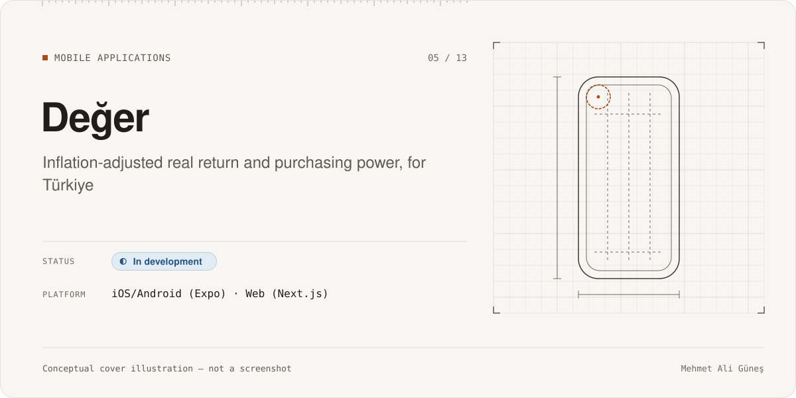
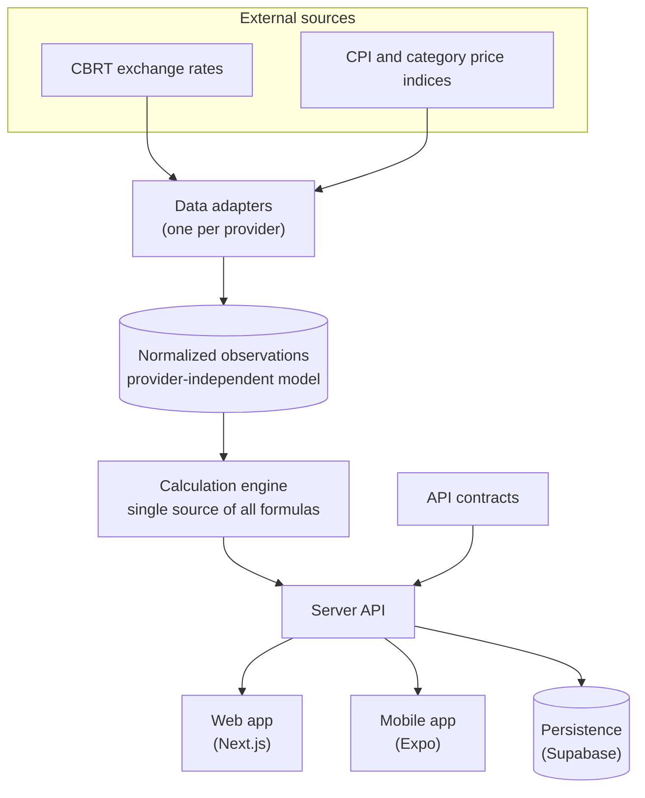
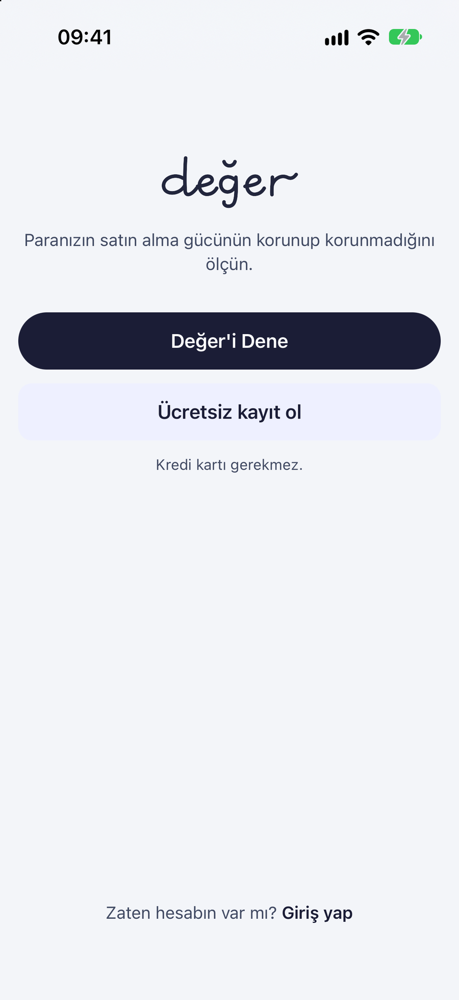
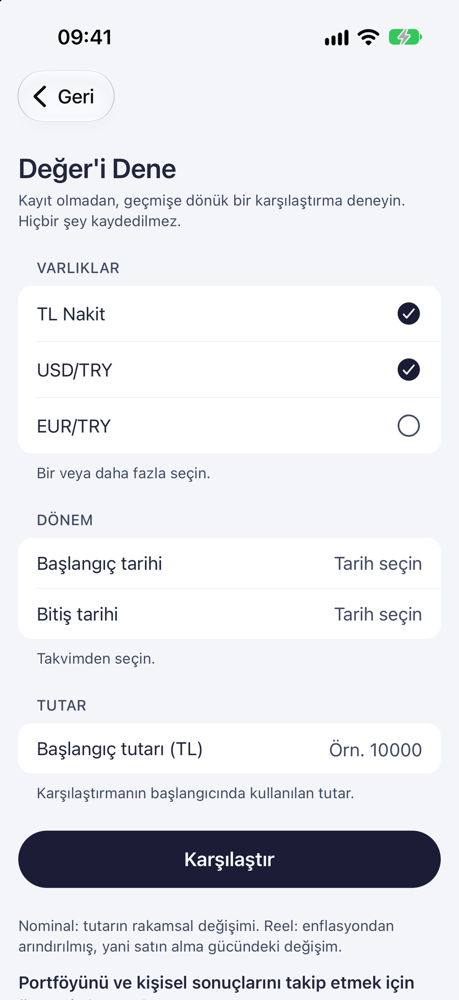
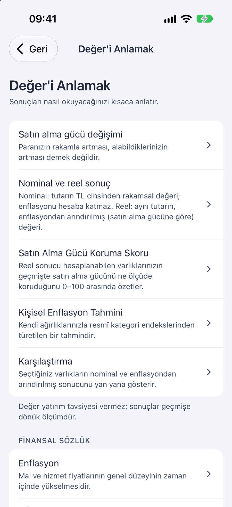
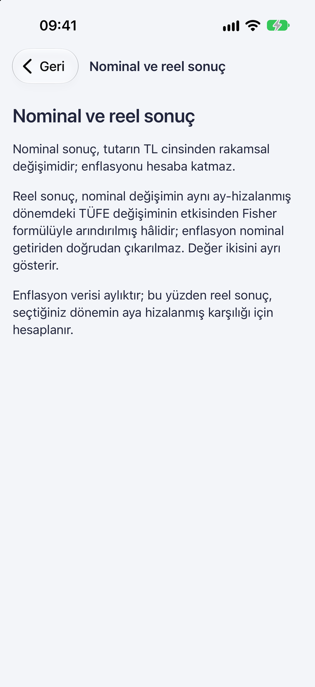

# Değer

**Category:** Mobile Applications · **Platform:** iOS (Expo / React Native) · Web (Next.js) · **Period:** Sep 2026 – present · **Source code:** private

> Shows people in Türkiye whether their savings really gained purchasing power. It separates nominal growth from inflation-adjusted (real) return, using official data sources and one canonical calculation engine.

## Overview

*Değer* means "value" in Turkish. In a high-inflation economy, a balance that grows in Turkish lira can still lose purchasing power. Değer answers one question: **"My money's number went up — did my purchasing power?"**

The user picks an asset and a period. The app then shows these values side by side, each clearly labeled:
- nominal return
- cumulative inflation
- real return
- purchasing-power change

Later milestones added:
- multi-asset comparison
- a personal portfolio view with price-level totals and a "protection score"
- a personal-inflation view
- scenarios
- notifications.

Değer is a **personal finance information tool, not investment advice**. It is in development and not published in an app store.

## Problem & Motivation

- People see nominal numbers (balance, investment value), but they rarely see the inflation-adjusted picture.
- Doing the calculation correctly is subtle:
  - official inflation data is monthly, while prices are daily
  - weekends, holidays and missing observations matter
  - mixing periods carelessly gives misleading results.
- Showing a wrong number in a finance app is worse than showing none.

## Solution

- **One canonical calculation engine.** All financial formulas live in one package. The API, web and mobile apps import it and never re-implement a formula, and a test enforces "no client-side calculation" in the mobile app.
- **Provider isolation.** Each data source has its own adapter that converts the provider's format into one normalized data model:
  - Central Bank of the Republic of Türkiye (CBRT) exchange rates
  - official CPI series via the CBRT EVDS service
  - category price indices.

  If a provider changes, only its adapter changes.
- **Month-aligned real return.** Nominal return uses the exact selected range. Inflation and real return are computed for the month-aligned equivalent of that range, and the UI labels this clearly.
- **Asset support matrix.** An asset becomes selectable only once its historical data source is verified. Data-layer support alone is not enough, so the app never shows a derived number as if it were measured.
- **One-way dependencies:** sources → adapters → normalized data → engine → API → apps.

## Key Features

### Implemented
- Single-asset analysis: TRY cash, USD/TRY, EUR/TRY. Nominal, inflation, real and purchasing-power results, each clearly labeled.
- Multi-asset historical comparison.
- Portfolio screen with price-level totals and a Protection Score (mobile and web).
- Personal inflation view, scenarios, and restatement notifications when official data is revised.
- "Understand" guide with a financial glossary and explanations of real return.
- Accounts (sign-up and login) and settings.
- Accessibility work: screens stay usable at large text sizes, and accessibility labels are tested.

### In progress
- Release gates for the v2 portfolio screens and the data-refresh flow.
- Closed-beta operations and deployment runbooks (documented, not executed publicly).

### Planned (not built)
- Further assets in the product flow (e.g. gram gold), once their historical source is verified for the product.

## Technologies

- **Language:** TypeScript across all packages
- **Apps:** Expo / React Native with Expo Router (mobile; iOS is the only validated mobile target, and an Android release is not planned); Next.js and React (web)
- **Backend:** server API package; Supabase client for authentication and persistence
- **Testing:** Vitest (engine, adapters, persistence, web, API, contracts) and Jest (mobile), plus ESLint, type-checking, a secret scan and an Expo export check
- **CI:** GitHub Actions, with pinned action versions, read-only permissions and no secrets in CI
- **Structure:** a monorepo with packages `calculation-engine`, `data-adapters`, `persistence`, `api-contracts`, `server-api`, `web` and `mobile`

## System Architecture

*Conceptual architecture diagram.*

Rule: dependencies only point downward. The engine knows nothing about providers or UI, and the apps display results without calculating.

## My Role & Contributions

- Product definition: the core question, target user, honest labeling rules, and the asset support matrix.
- Calculation specification: nominal vs. real vs. purchasing power, month alignment, and edge cases. The architecture rules (single engine, provider isolation, dependency direction) are written into the project specifications.
- Milestone planning, manual simulator checks for visual and interaction quality, and acceptance of each phase.

**AI-assisted development:**
- The TypeScript code and tests were written by AI coding agents under my specifications.
- An independent AI reviewer checked the finance-critical changes.
- See [AI-assisted development](../../docs/ai-assisted-development.md).

## Testing & Validation

| Evidence | Scope | Result | Label |
|---|---|---|---|
| Full CI-mode validation, run locally | 16 steps: type-checks, ESLint, Vitest (engine, adapters, persistence, web, API, contracts), Jest (mobile), secret scan, Expo iOS export | **All 16 steps PASS** | **RE-RUN 2026-11-10**, latest commit |
| GitHub Actions CI | Same validation on `main` | Last 5 runs successful, latest on the same commit | CI 2026-11-06 |
| Test files | All packages | 141 files | STATIC |

Honest note on today's run: the **first** local run on 2026-11-10 failed one of 1,563 mobile Jest tests. It was a render test that exceeded its 5-second timeout while the machine was busy with other builds, and the fail-fast runner then skipped the remaining steps. The same test file passed 23/23 when re-run on its own, and a second full run passed all 16 steps. This points to a timing-sensitive test, which is noted as a follow-up.

## Current Development Status

**In development.**
- Core analysis, comparison and portfolio features are implemented, and CI is green.
- Release gates and beta operations are still open.
- Not published in an app store.

## Screenshots / Visuals

Real screenshots from a **Debug build in the iOS Simulator** (Turkish interface). These are the screens that work **without a backend**: welcome, the try form (not submitted) and the explainer guide. The result, portfolio and signed-in screens need the API and real market data, so they are **not shown**. The data flow is in the conceptual diagram above. Captured 2026-11-10.

| | | | |
|---|---|---|---|
|  |  |  |  |
| Welcome | Try form | Understand guide | Nominal vs. real |

Facts as of 2026-11-10. Evidence labels: RE-RUN, RECORDED, STATIC, CI. See [status legend](../../docs/status-legend.md). Değer provides information, not investment advice.
