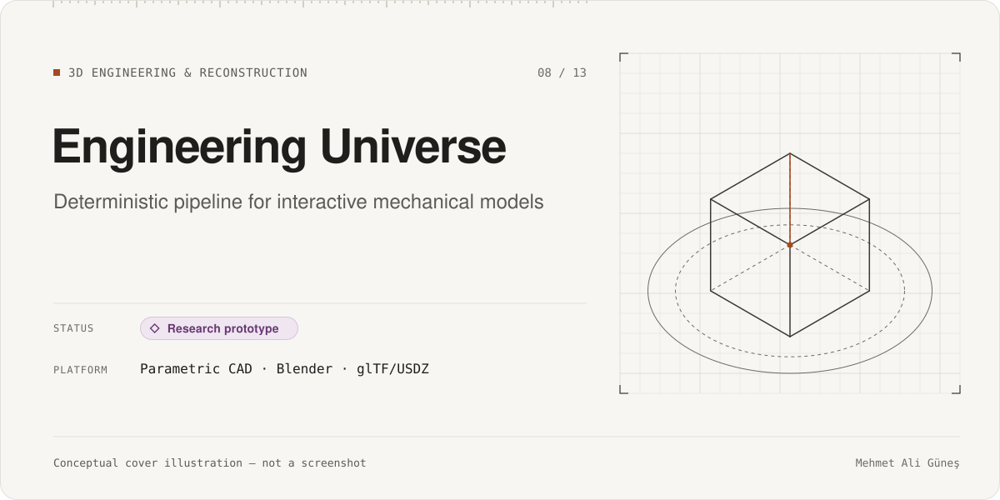
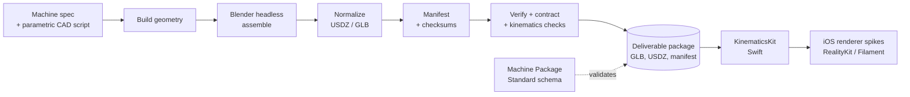

# Engineering Universe

**Category:** 3D Engineering & Reconstruction · **Platform:** Parametric CAD pipeline → iOS (planned app) · **Period:** Oct 2026 – present · **Source code:** private

> A planned iPhone encyclopedia and 3D lab for mechanical systems. The current work is a research prototype: a deterministic pipeline that turns one parametric machine (a planetary gear set) into verified, app-ready 3D assets.

## Overview

The long-term idea is an interactive engineering reference for iPhone, where each machine is a parametric model you can explore and animate. Before building any app UI, I focused on the hardest part to change later: how machines are specified, generated, checked and delivered. Milestone M0 builds one machine end to end and proves the pipeline is repeatable.

## Problem & Motivation

Educational 3D content is often hand-made, hard to update and impossible to verify. If machines are generated from specifications, they can be checked automatically (geometry, assembly, kinematics) and rebuilt identically. I wanted to find out whether that was practical before investing in an app.

## Solution

- A machine is described by a spec file plus a parametric CAD script.
- A staged pipeline builds the geometry, assembles it in Blender (headless), normalizes it to USDZ/GLB, and writes a manifest with checksums.
- The pipeline then verifies the output against a contract, including kinematic checks.
- A shared "Machine Package Standard" (a JSON schema with fixtures) defines what a deliverable machine package must contain, including source attribution.
- A small Swift package (`KinematicsKit`) with golden tests is the start of the on-device side.

## Key Features

### Implemented
- Parametric planetary gear set generated from a spec (build123d / OpenCascade).
- Staged pipeline: build → Blender assemble → USDZ normalization → manifest → verify → contract → kinematics checks.
- Deliverable package with GLB, USDZ, manifest, SHA-256 sums, and a determinism record.
- Machine Package Standard schema with fixtures and tests.
- Two iOS renderer spikes (RealityKit and Filament) for a renderer comparison.

### In progress
- Choosing the iOS renderer: the on-device comparison has not completed, so no renderer has been chosen.
- Closing the review findings of the first milestone (first-pass independent review: FAIL, followed by fixes; no final pass yet).

### Planned (not built)
- The iOS app itself (no app UI exists yet).
- Further machines (one exists; the plan targets about two dozen).
- Cross-machine determinism and a production UV/texturing path (only a spike exists).

## Technologies

Python automation/generation scripts written with AI assistance (build123d / OpenCascade, trimesh, headless Blender) · Node.js glTF tools (glTF-Transform, glTF Validator) · USDZ / glTF · Swift (Swift package with golden tests) · RealityKit and Filament (spikes) · JSON Schema · pytest

## System Architecture

*Conceptual architecture diagram.*

## My Role & Contributions

- Defined the product vision and the "spec first, verify everything" approach.
- Defined the package standard and the milestone gates.
- Reviewed pipeline evidence, decided what counts as done, and kept the failed review findings visible instead of declaring the milestone complete.

**AI-assisted development.** The product decisions, requirements, architecture choices, acceptance gates and verification were mine. Most of the code was written with AI coding agents (Claude Code) under my direction and review, and a separate AI model (Codex) was used as an independent reviewer. I do not present the Python scripts as Python expertise.

**Third-party components**
- build123d / OpenCascade, trimesh, Blender, glTF-Transform / glTF Validator (open-source tools).
- Filament (Apache-2.0), used only in a renderer spike.

## Testing & Validation

- Full pipeline test suite: 89 passed / 0 failed; package-standard suite: 75 passed (**RECORDED**, 2026-10-23, JUnit reports; not re-run).
- Determinism: 20/20 identical rebuild hashes on one machine (**RECORDED**). Cross-machine determinism has **not** been tested.
- First-pass independent review of the milestone: **FAIL**, followed by fixes. No final pass has been recorded, so the milestone is not accepted.
- Renderer comparison on a physical iPhone did not complete, so it is not verified.

## Current Development Status

**Research prototype.** A single machine has been taken through a verified, repeatable pipeline. The app, the renderer decision and further machines are not built, and the milestone acceptance is still open.

## Screenshots / Visuals

Planned visuals (procedural content only): renders of the generated planetary gear set and a pipeline-stage diagram. No manufacturer CAD data or logos are used.

---
Facts as of 2026-11-10. Evidence labels: RE-RUN = re-executed on that date; RECORDED = taken from the project's own dated report, not re-run; STATIC = file/code count; CI = GitHub Actions record. See ../../docs/status-legend.md.
