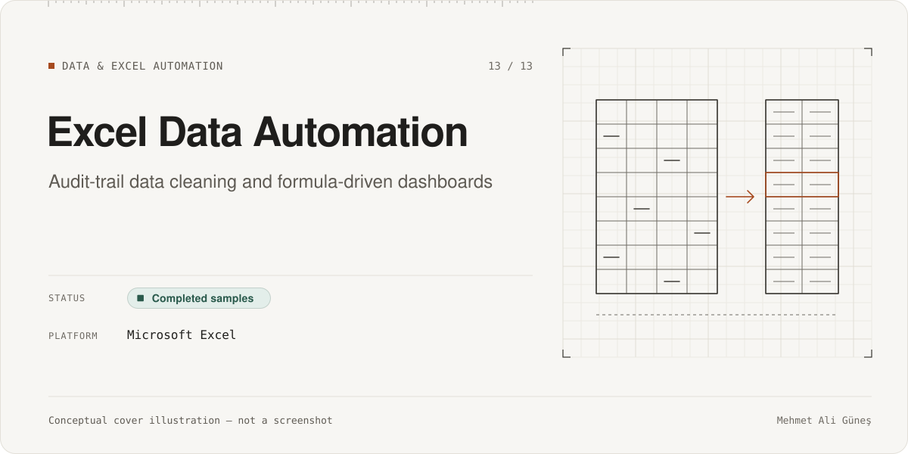
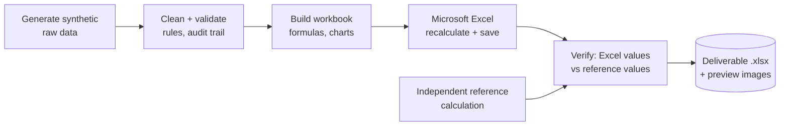

# Excel Data Automation

**Category:** Data & Excel Automation · **Platform:** Microsoft Excel · **Period:** Nov 2026 · **Source code:** private; the workbooks can be shared on request

> Two client-style Excel deliverables built on fully synthetic data: a sales-data cleaning workbook with a complete audit trail, and a formula-driven inventory dashboard. Each is checked against an independent reference calculation before delivery.

## Overview

These are portfolio samples for freelance data work, not client projects. All names, products, suppliers and e-mail addresses are invented.

- **E-commerce Sales Data Cleaning & Dashboard:** a messy order export (150 rows) is cleaned, validated and turned into a dashboard. Nothing is deleted silently.
- **Inventory Intelligence Dashboard:** a multi-warehouse stock workbook (500 stock positions, 160 products, 4 warehouses) with KPIs, charts, a reorder list and live reconciliation checks.

## Problem & Motivation

Spreadsheet clean-ups often "fix" data by guessing, and dashboards often cannot be traced back to their rows. I wanted samples that show a stricter way of working:

- never invent data;
- flag what cannot be resolved;
- make every dashboard number reconcile with the underlying table.

## Solution

1. Synthetic raw data is generated with deliberate problems: duplicates, six date layouts, 38 product spellings, extra spaces and missing values.
2. Cleaning rules are applied, and each record keeps its source row, actions taken and an include/exclude reason. Ambiguous dates are left blank and flagged.
3. Dashboards use native Excel formulas and charts (no macros, no pivot caches, no external links).
4. The workbook is recalculated in Microsoft Excel, then verified against independently computed reference values.

## Key Features

### Implemented
- **Sales cleaning workbook:**
  - Raw (150 rows) → Clean, a full audit trail (150 rows) → Final (108 reportable orders) → Dashboard with 3 charts and reconciliation checks.
  - Explicit handling of exact duplicates, conflicting duplicate order IDs, unresolved records and cancelled orders.
- **Inventory workbook:**
  - Dashboard with 6 KPI cards, 5 native charts, a top-10 reorder list and a warehouse snapshot.
  - Fact and dimension tables.
  - 26 live PASS/FAIL reconciliation checks inside the workbook.
  - Editable settings and a built-in guide (about 10,000 formulas).

### In progress
- None.

### Planned (not built)
- None.

## Technologies

Microsoft Excel (formulas, `INDEX/MATCH`, native charts, data validation, conditional formatting) · Python generation and verification scripts written with AI assistance (openpyxl, pandas) · a small Swift helper for preview images

## System Architecture

*Conceptual architecture diagram.*

## My Role & Contributions

- Defined the deliverables, the cleaning rules (including "never invent data" and how ambiguity is handled), the KPI definitions and the acceptance checks.
- Reviewed the workbooks in Excel.

**AI-assisted development.** The scripts that generate and verify the workbooks were written with AI coding agents under my direction and review. I do not present them as Python expertise. The Excel logic, the rules and the acceptance criteria were mine.

**Third-party components:** openpyxl, pandas and Pillow (open-source libraries); Microsoft Excel.

## Testing & Validation

- **Sales cleaning workbook:** 57/57 verification checks passed. Excel recalculated 590 formula cells, with 0 differences from stored values (**RECORDED**, 2026-11-09; not re-run).
- **Inventory workbook:** 84/84 verification checks passed against pandas reference values (**RECORDED**, 2026-11-10; not re-run).
- The inventory workbook also carries 26 live reconciliation checks that run inside Excel.

## Current Development Status

**Completed samples.** Both workbooks are finished and verified. They are samples on synthetic data, not client work.

## Screenshots / Visuals

No screenshots are shown yet. The workbooks use synthetic data only; a reviewed selection of dashboard images can be added later. The conceptual cover above is an illustration, not a screenshot.

---
Facts as of 2026-11-10. Evidence labels: RE-RUN = re-executed on that date; RECORDED = taken from the project's own dated report, not re-run; STATIC = file/code count; CI = GitHub Actions record. See ../../docs/status-legend.md.
