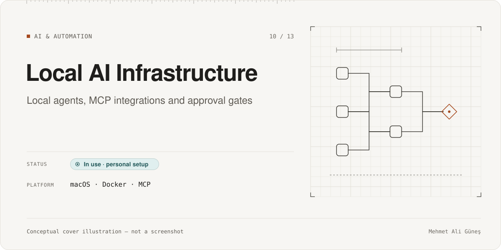
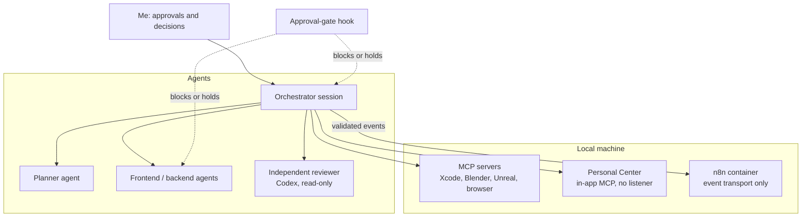

# Local AI Infrastructure & MCP Integrations

**Category:** AI & Automation · **Platform:** macOS · Docker · MCP · **Period:** 2026 – present · **Source code:** private (personal configuration)

> My working environment for AI-assisted engineering: role-based coding agents with approval gates and an independent reviewer, local services in containers, and MCP connections to engineering and creative tools. This page separates what I built from the third-party systems I installed and configured.

## Overview

Most projects in this portfolio were built inside this environment. It has three layers:

1. **Agent workflow:** a single orchestrating session that delegates to planner, implementation (frontend / backend) and independent reviewer agents.
2. **Guardrails:** an approval-gate hook that blocks risky operations unless I approve them.
3. **Integrations:** MCP servers and local services (containers) that connect agents to tools such as Xcode, Blender, Unreal Engine and a browser.

The custom MCP work, where I designed the server or the security boundary, is described in its own case studies:

- [Personal Center](../personal-center/): an MCP server hosted inside a native app, with no network listener.
- [SolidWorks MCP Bridge](../solidworks-mcp-bridge/): a default-deny policy proxy between an agent and CAD software.

## Problem & Motivation

AI coding agents are fast, but they will happily run destructive git commands, touch production data, or review their own work. I wanted three things:

- speed from agents;
- hard stops for anything irreversible;
- a reviewer that is independent of the model that wrote the code.

I also wanted local services and tool integrations without exposing them to the network.

## Solution

### (a) Components I built or authored
- **Approval-gate guard hook.** About 600 lines of Python, written with AI assistance. It intercepts agent tool calls and blocks or holds STOP-class operations until I explicitly approve them. Examples: git writes, force operations, history rewrites, release/signing commands. Git commits and pushes need a one-time, time-limited grant. It is **not covered by automated tests.**
- **Role-based multi-agent setup.** Agent definitions for planner, frontend, backend and reviewer roles, plus an orchestrator output style. Only the orchestrator delegates and performs git writes. Reviews run through a different vendor's model (OpenAI Codex, read-only sandbox), so code is never approved by the model that wrote it.
- **[Agent Status Bar](../agent-status-bar/).** A plugin that shows live agent status.
- **Event transport contract for Personal Center.** A JSON-schema-validated "development state event" that is sent to a local n8n workflow, which only transports it (no agent logic in n8n). Details are in [Personal Center](../personal-center/).

### (b) Third-party systems I installed and configured
- **Docker** for local services.
- **n8n** (workflow automation) in a container, as a local transport for development events.
- **Supabase local stack** via the Supabase CLI, for local database and auth development and tests.
- **Docker MCP Toolkit**: installed, not yet configured.
- **Hermes Agent** (Nous Research): installed for evaluation; third-party and not part of my workflow code.
- **MCP servers configured for coding agents:** Perplexity (research), Chrome DevTools (browser debugging), Xcode, Blender, and Unreal Engine's MCP plugin.

## Key Features

### Implemented
- Approval gates for git writes, destructive operations, release, signing and deployment.
- Role separation with an independent, read-only reviewer from another model vendor.
- Containerized local development services (n8n, a local Supabase stack for development and tests).
- MCP integrations used in practice for Xcode builds, Blender asset generation, Unreal Engine editing and browser checks (see the related case studies).

### In progress
- Moving older per-project orchestration setups to the shared global agent setup.

### Planned (not built)
- Configuring the Docker MCP Toolkit profile.
- Automated tests for the guard hook.

## Technologies

Claude Code (agents, hooks, plugins, output styles) · OpenAI Codex CLI (reviewer) · MCP · Docker · n8n · Supabase CLI · Python guard hook (written with AI assistance) · JSON Schema

## System Architecture

*Conceptual architecture diagram.*

## My Role & Contributions

- Designed the agent roles, the delegation and approval rules, and the reviewer-independence rule.
- Specified the guard hook's STOP classes.
- Chose which integrations to install and how to bind them.
- Authored the event contract between Personal Center and n8n.

**AI-assisted development.** The decisions, rules and acceptance checks were mine. The guard hook and the configuration were written with AI coding agents under my direction and review. I do not present this as Python expertise. Third-party systems are listed above as installed and configured, not built.

## Testing & Validation

- This page has **no automated test evidence of its own.** The guard hook is not covered by automated tests; its behavior is observed in daily use.
- Verified MCP security boundaries are documented with their tests in [Personal Center](../personal-center/) and [SolidWorks MCP Bridge](../solidworks-mcp-bridge/).

## Current Development Status

**In use (personal setup).** I use it daily. Remaining work: tests for the guard hook, configuring the Docker MCP Toolkit, and finishing the migration of older project setups.

## Screenshots / Visuals

Planned visuals: the architecture diagram above, and a redacted screenshot of an approval prompt with no paths, ports, account names or project data.

---
Facts as of 2026-11-10. Evidence labels: RE-RUN = re-executed on that date; RECORDED = taken from the project's own dated report, not re-run; STATIC = file/code count; CI = GitHub Actions record. See ../../docs/status-legend.md.
