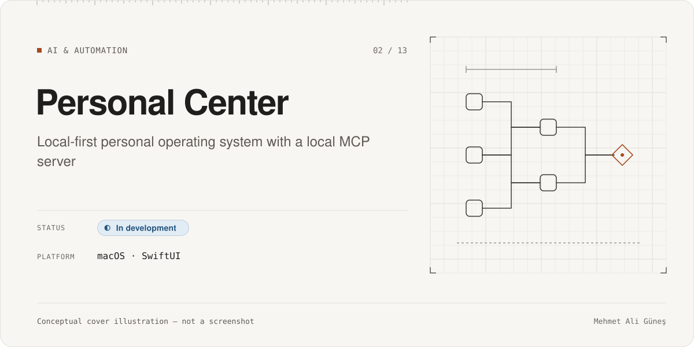
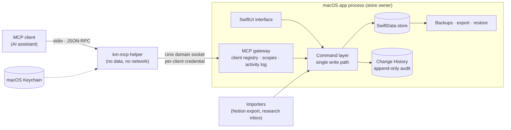
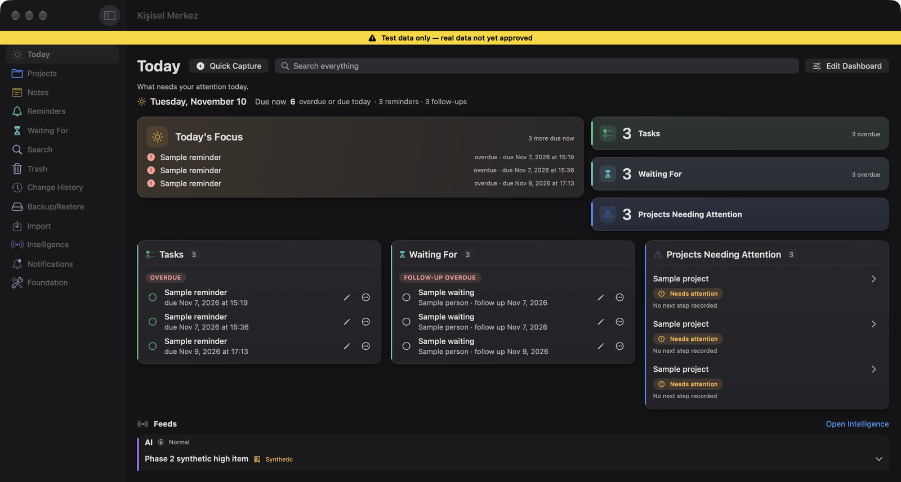
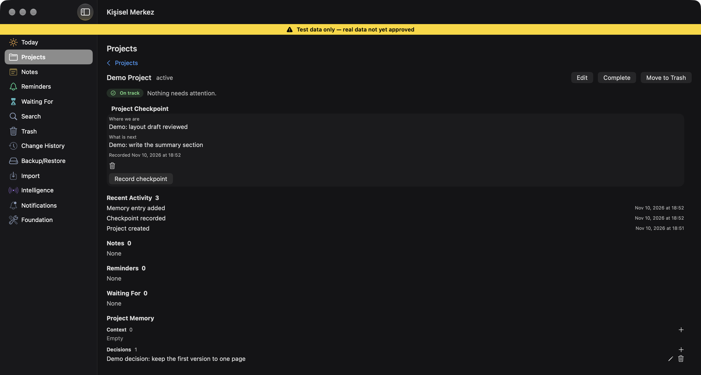
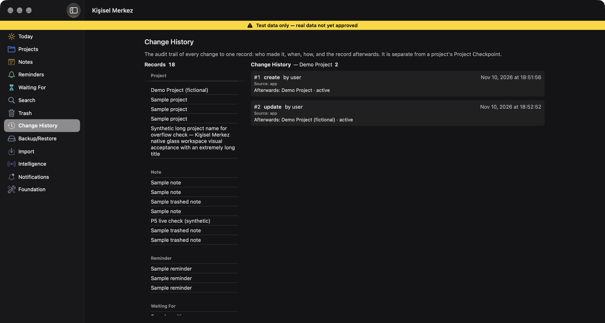

# Personal Center

**Category:** AI & Automation · **Platform:** macOS (SwiftUI) · **Period:** Oct 2026 – present · **Source code:** private

> A local-first macOS personal system for projects, notes, reminders and project memory. Every change goes through one audited command layer, and AI assistants connect through a local MCP server that opens no network port.

## Overview

Personal Center (Turkish: *Kişisel Merkez*) is a native macOS app that I am building as a single local source of truth for projects, notes and reminders. These currently live in separate tools such as Notion.

Its central design rule is **"AI-assisted, not AI-dependent"**:
- Every core feature works deterministically without AI.
- AI tools are optional clients. They can read through narrow, intent-scoped tools and write only through the same validated command layer as the UI.

It is **not in daily use yet**, by design. I decided to finish the integrated product first (phases F0–F7 with an integrated acceptance gate) before moving my real data and leaving Notion. Development and testing use isolated builds with **synthetic data**.

## Problem & Motivation

- My project notes, checkpoints and reminders are spread across several tools. AI assistants could only see them through copy and paste.
- Giving an AI assistant *write* access to personal data is risky:
  - a generic "update anything" tool
  - a local HTTP port
  - or an untracked change

  can corrupt data silently or expose it.
- I wanted AI assistants to be able to resume a project or record a session summary, with every change attributable, reversible and auditable.

## Solution

- **One write path.** UI actions, MCP calls, imports and background jobs all go through typed commands. Each write records the actor, provenance, timestamps and a Change History entry (append-only, with post-images and idempotency keys). This makes undo, trash and restore possible.
- **Local MCP without a network listener.**
  1. The MCP client starts a small stdio helper. The helper holds no data.
  2. The helper talks to the running app over a local Unix-domain-socket IPC with a per-client credential stored in the macOS Keychain.
  3. The app's MCP gateway checks the client, applies the tool's scope, and runs the same commands as the UI.
- **Narrow tools.** There is no generic insert, update or delete. The tools are domain-specific (for example *add note*, *create reminder*, *write session end*), and the reads are intent-scoped (for example *resume snapshot*, *today list*, a capped *search*).
- **Data safety first.**
  - Daily backups, encrypted export, restore, and versioned schema migrations (V1 → V8), each rehearsed on synthetic fixtures.
  - Development and test builds never share a store with any real-data build.

## Key Features

### Implemented
- Projects, notes, reminders (with recurrence), waiting-for items, checkpoints, project memory, and a Today hub. Project health and a notification planner.
- Change History with undo, trash, restore and permanent delete (permanent delete needs approval).
- Daily backups, encrypted export, a restore gate, and diagnostics.
- Schema migrations V1 → V8, each with synthetic fixture tests.
- A deterministic Morning Brief and a Today command center. Both are implemented in a synthetic Debug build; part of their behaviour is still NOT VERIFIED (see below).
- A Notion export importer: mapping, scale tests and a public-API naming check.
- Intelligence ingest: structured research items enter through a validated file inbox and a job queue. No AI output is written to the store directly.
- **Local MCP server.** A stdio helper plus Unix-domain-socket IPC, per-client credential enrollment in the Keychain, a client registry, an MCP activity log, and a listener switch that is **off by default**.
- 13 MCP tools (STATIC count, 2026-11-10):
  - 8 intent-scoped read tools
  - 5 domain-specific write tools.

### In progress
- V1.1 release readiness. Production wiring of MCP to the real data store is **off** (`productionWired=false`) and gated by a separate approval.
- Completing the integrated product scope (phases F0–F7) before first daily use.

### Planned (not built)
- Real-data migration and first daily use: **deferred** to the final integrated acceptance gate. A new explicit decision is required then.
- Further "intelligence" producers (e.g. scheduled research feeds).
- Notion exit: moving the project memory fully into the app.
- iPhone companion and CloudKit sync (the data model is prepared for it; nothing is enabled).

## Technologies

- **App:** Swift, SwiftUI, SwiftData, macOS Keychain
- **Core:** a local Swift package (`KMCore`) with domain, command, history, backup and import modules
- **MCP:** JSON-RPC over stdio (client side); Unix domain socket IPC (helper ↔ app)
- **Testing:** XCTest / Swift Testing, XCUITest, plus shell- and Python-based verification scripts (written with AI assistance)
- **Workflow:** Notion receives only human-readable checkpoint summaries, delivered through an n8n transport. The app itself never depends on n8n or Notion.

## System Architecture

*Conceptual architecture diagram.*

Security model, honestly stated:
- Per-client credentials give scoping, revocation and attribution between cooperating clients.
- They **do not** isolate the app from malware running as the same macOS user.
- No MCP transport listens on a network interface.

## My Role & Contributions

- Requirements, product rules and the architecture baseline: source-of-truth matrix, single write path, MCP trust boundary, and STOP gates for real data, signing and schema changes.
- I chose the MCP direction (the app hosts MCP, no daemon, no network listener). I chose it after an external technical validation and a proof of concept for the IPC transport.
- I defined milestone plans and gates and verified each milestone. I keep the "not verified" list current.

**AI-assisted development:**
- Most Swift code, tests and verification scripts were written by AI coding agents under my plans and review.
- Planner and independent-reviewer agents were part of each milestone (see [AI-assisted development](../../docs/ai-assisted-development.md)).

## Testing & Validation

| Evidence | Scope | Result | Label |
|---|---|---|---|
| Test declarations | Core (≈ 90 test files), IPC protocol, MCP stdio helper (end-to-end, Keychain enrollment, token and socket checks), UI tests | ≈ 1,100 declarations | STATIC 2026-11-10 (not re-run for this portfolio) |
| Schema migration rehearsal | Synthetic V4 → V5 migration, idempotency, rollback at 4 fault points | 35 / 35 PASS WITH NOTES | RECORDED 2026-11-04 |
| MCP security criteria | No network listener; authenticated local IPC; single write path with audit trail; rejection of unauthorized calls | Covered by dedicated tests | STATIC (test suites present) |

Not verified, and listed in the project:
- the full UI-test suite on the latest committed state
- Morning Brief with filled metadata and the stale hint (needs a real scheduled trigger)
- the real GUI lifecycle (close window / quit)
- Release-build behaviour and distribution signing
- re-enrolling the helper after every rebuild is still a manual step.

## Current Development Status

**In development.**
- The core and the local MCP layer are implemented and covered by tests.
- It is not in daily use yet. Production MCP wiring and any real-data migration are deferred to the final integrated acceptance gate.

## Screenshots / Visuals

Real screenshots from a **Debug development build with a synthetic data store**. The yellow banner in the app ("Test data only, real data not yet approved") is part of the build. The screens show work-in-progress UI, so details may change.

| | |
|---|---|
|  |  |
| Today hub | Project view with checkpoint and project memory |
|  | |
| Change History: the audit trail of every write | |

Not shown: the MCP Clients settings and activity log. The architecture is in the diagram above (conceptual).

Facts as of 2026-11-10. Evidence labels: RE-RUN, RECORDED, STATIC, CI. See [status legend](../../docs/status-legend.md).
