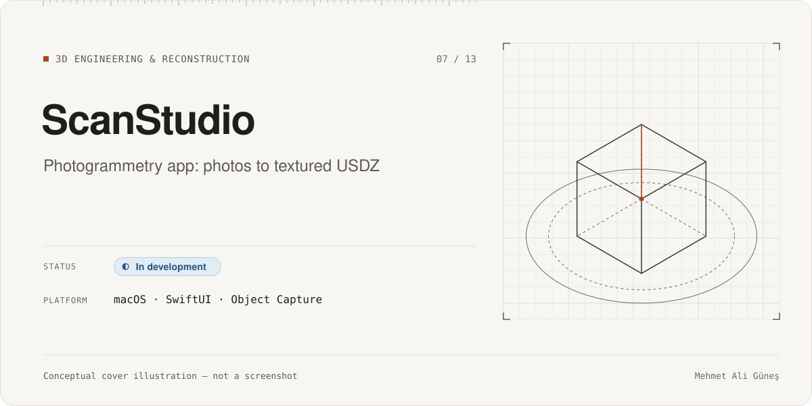
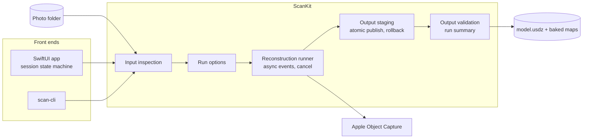
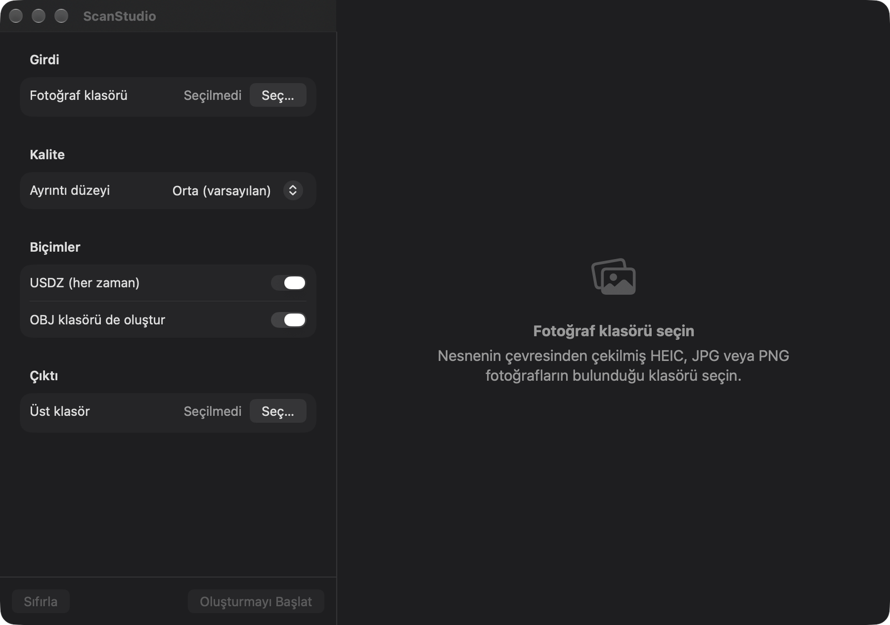

# ScanStudio

**Category:** 3D Engineering & Reconstruction · **Platform:** macOS (SwiftUI app + command-line tool) · **Period:** Nov 2026 – present · **Source code:** private

> A native macOS app and CLI that turn a folder of photos into a textured USDZ model with Apple's Object Capture, built around a safe, cancellable and verifiable reconstruction pipeline.

## Overview

ScanStudio wraps Apple's photogrammetry API (`PhotogrammetrySession`) in a small, defensive pipeline. A user picks a folder of HEIC photos. The app inspects the input, runs the reconstruction with progress and cancellation, stages the output, publishes it atomically, and validates the result before calling the run finished. A command-line tool shares the same core package, so scripted runs and the GUI behave the same way.

## Problem & Motivation

Photogrammetry runs are long, memory-heavy, and easy to leave in a half-written state. A cancelled or crashed run can leave a partial model that looks valid. I wanted a desktop tool where a run is either complete and checked or clearly not, so I could use scans as inputs for other 3D work, such as reconstruction and engineering models.

## Solution

- A shared Swift package (`ScanKit`) holds the pipeline. The SwiftUI app and the CLI are thin front ends.
- The run is modeled as an explicit state machine: idle → inspecting → ready → running → cancelling → finished.
- Output is written to a staging folder first and published with an atomic rename. If publishing fails, the rollback is reported, not hidden.
- A validation step and a run summary confirm what was produced.

## Key Features

### Implemented
- Input inspection of a photo folder before a run starts.
- Reconstruction through Apple Object Capture with an async event stream, progress, and cancellation (with a cancel timeout).
- Staged output with atomic publish and rollback reporting.
- Output validation and a per-run summary; timestamped run folders.
- SwiftUI interface: photo grid with thumbnail loading, model preview, memory-pressure banner, and security-scoped folder access (sandboxed app).
- CLI front end sharing the same package.
- End-to-end reconstructions produced from a test photo set (USDZ plus baked texture, normal and ambient-occlusion maps).

### In progress
- A documented capture protocol for a reference object, including scale calibration (the protocol exists; the capture itself and its scale check are not done).

### Planned (not built)
- Packaging and distribution.
- Later quality gates after the first GUI milestone.

## Technologies

Swift 6 · SwiftUI · Swift Package Manager · Apple RealityKit Object Capture (`PhotogrammetrySession`) · USDZ · Xcode · XCTest / Swift Testing

## System Architecture

*Conceptual architecture diagram.*

## My Role & Contributions

- I defined the product goal, the pipeline stages, and the safety rules: no partial output is published, cancellation must be clean, and every run is validated.
- I set the milestone gates and reviewed hardening reports before accepting each stage.

**AI-assisted development.** The product decisions, requirements, architecture choices, acceptance gates and verification were mine. Most of the code was written with AI coding agents (Claude Code) under my direction and review, and a separate AI model (Codex) was used as an independent reviewer.

**Third-party components**
- Apple Object Capture / RealityKit (system frameworks).
- Apple sample code (HelloPhotogrammetry, Object Capture reconstruction sample) was kept as a reference under Apple's sample-code license. It is not part of my code and is not redistributed here.

## Testing & Validation

- About 142 automated tests: the core package (~82), app unit tests (~44), and UI tests (~15) — **STATIC**, 2026-11-10.
- Test runs and hardening fixes are documented in the project's own reports (**RECORDED**, 2026-11-05 to 2026-11-06; not re-run for this page).
- Real reconstructions exist as artifacts (USDZ and baked maps) from 2026-11-05 and 2026-11-06 (**STATIC**).

## Current Development Status

**In development.** A working vertical slice exists: GUI, CLI, and a hardened pipeline, with real reconstructions produced. Not done yet: the reference-object capture, scale calibration, later quality gates, and any packaging or release.

## Screenshots / Visuals

The main window of a Debug build before any input is chosen (the interface is currently in Turkish). Screenshots of a loaded photo set and of the model preview are **not shown**: they need an interactive reconstruction run, and the source photos are personal. The pipeline is described in the conceptual diagram above.

Facts as of 2026-11-10. Evidence labels: RE-RUN = re-executed on that date; RECORDED = taken from the project's own dated report, not re-run; STATIC = file/code count; CI = GitHub Actions record. See ../../docs/status-legend.md.
