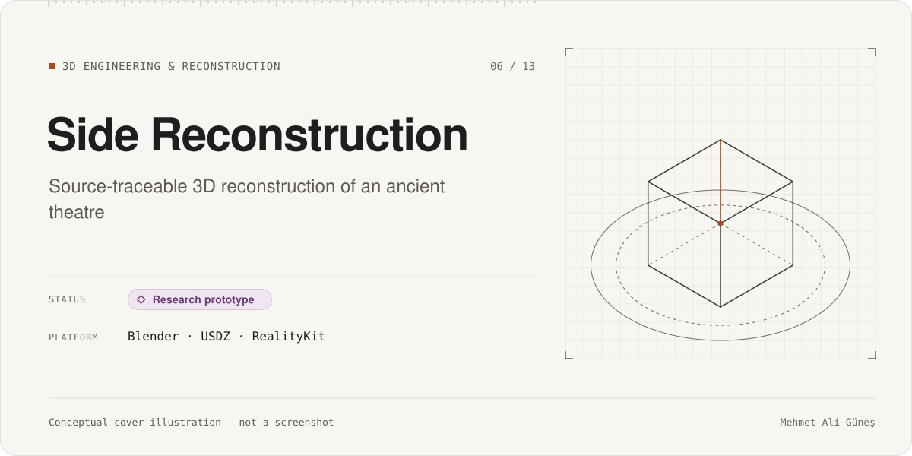
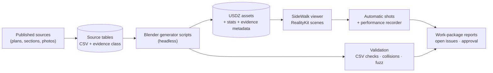

# Side Reconstruction

**Category:** 3D Engineering & Reconstruction · **Platform:** Blender (scripted) → USDZ → RealityKit app for macOS · **Period:** Oct 2026 – present · **Source code:** private

> A **hypothetical** 3D reconstruction of the Roman theatre and agora complex at Side, Türkiye. Every generated mesh is traced back to a published source and labeled with how certain it is.

## Overview

Side is an ancient city on the southern coast of Türkiye with a large Roman theatre. This project rebuilds parts of the theatre complex in 3D:
- the seating (cavea)
- the arcaded façade and vaults
- the entrances and circulation routes
- a street "lab" area.

The models can be explored in a small RealityKit viewer app called **SideWalk**.

The project is less about pretty pictures than about **traceability**. Each piece of geometry records which source it comes from, and whether its dimensions are *verified*, *inferred*, *assumed* or *unknown*. Where the sources disagree or are missing, the project says so instead of inventing detail.

This is a **research prototype and a hypothetical reconstruction**, not an archaeological publication.

## Problem & Motivation

Digital reconstructions of historical buildings often look convincing while mixing measured facts with guesses, and viewers cannot tell which is which. I wanted a pipeline where:
- measurements from the literature are captured as structured data, not just as visual reference
- geometry is **generated by scripts from that data**, so it can be regenerated and checked
- every part carries its evidence class into the final 3D asset
- conflicts (for example between two published elevations) stay visible as open issues.

## Solution

1. **Source tables.** Work packages turn measurements from published plans, sections and photographs into CSV tables. Each row has a source reference and an evidence class.
2. **Scripted geometry.** Blender is driven headlessly by generator scripts that read those tables and build the meshes. The scripts are Python, written with AI assistance. Each asset records its evidence class as a mesh property, and the scripts write statistics files for checking.
3. **USDZ export** for each work package.
4. **SideWalk viewer** (Swift, RealityKit). It has one scene per work package, shared mesh instances, per-region culling, an automatic screenshot-shot system, and a performance recorder.
5. **Reports.** Each work package ends with a written report, renders, open questions and a visual-approval step.

## Key Features

### Implemented
- Source-traceable work packages for the lower, upper and full cavea, gallery and arcade, façade elements, surface classes, entrances and circulation, and a street lab.
- Hundreds of generated USDZ assets with per-mesh evidence classes and statistics.
- The SideWalk RealityKit viewer, with 70 Swift scene and tool sources, automatic shots and performance recording.
- A placement framework (city frame and street-lab JSON schemas with test vectors).
- Validation scripts: source-CSV checks, a collision test runner, and fuzz tests for the source registry.
- About 155 work-package reports, including honest failure reports.

### In progress
- Unresolved conflicts, documented openly:
  - an access-feasibility check for one level of the seating failed
  - a 1–2.7 m datum conflict between sources
  - some step dimensions and stair positions are assumed
- Several packages are graded "partial" or are waiting for visual approval.

### Planned (not built)
- A full integrated historical assembly of the complex. Placement waits for a scaled site plan.

## Technologies

- **3D:** Blender (headless and via the Blender MCP server), USD/USDZ
- **Viewer:** Swift, RealityKit, XcodeGen
- **Data:** CSV source tables, JSON schemas
- **Scripting:** Python generator and validation scripts, written with AI assistance
- **Tooling:** installed Blender agent skills (third-party) used for workflow guidance

**Third-party and source material:**
- Measurements come from published academic literature, including 19th- and 20th-century surveys and recent studies.
- **Reproductions of those publications (plans, plates, photographs) are not published here** for copyright reasons. Only my own renders are shown.

## System Architecture

*Conceptual architecture diagram.*

## My Role & Contributions

- Research direction: which parts of the complex to reconstruct, which sources to trust, and how to treat conflicts.
- Defined the evidence-class model and the rule that every mesh must be traceable.
- Planned the work packages, reviewed the renders, and gave or withheld visual approval.

**AI-assisted development:**
- The generator scripts, the Swift viewer and most of the reports were produced with AI coding agents, including agent-driven Blender, under my direction and review.
- See [AI-assisted development](../../docs/ai-assisted-development.md).

## Testing & Validation

| Evidence | Scope | Result | Label |
|---|---|---|---|
| Validation scripts | Source-CSV integrity, collisions, registry fuzz tests, placement test vectors | Results recorded in the work-package reports; there is no consolidated result file | RECORDED (per report) |
| Assets and scenes | USDZ assets, Swift scene sources | ≈ 295 USDZ files, 70 Swift sources | STATIC 2026-11-10 |
| Open-issue reports | Failed feasibility check, datum conflict, assumed dimensions | Documented as open | RECORDED |

The project is not under version control yet, so there is no commit history to cite.

## Current Development Status

**Research prototype.**
- The pipeline and viewer work, and many components are built and documented.
- An integrated, fully placed reconstruction does **not** exist yet.
- Several dimensions remain assumed or in conflict, and they are labeled as such.

## Screenshots / Visuals

Planned visuals (my own renders only; no source plates or photographs):
1. Overview render of the cavea and façade
2. Close-up of the column/arcade geometry
3. A view colored by evidence class (verified / inferred / assumed)
4. The pipeline diagram above

Facts as of 2026-11-10. Evidence labels: RE-RUN, RECORDED, STATIC, CI. See [status legend](../../docs/status-legend.md). This is a hypothetical reconstruction for research and portfolio purposes.
