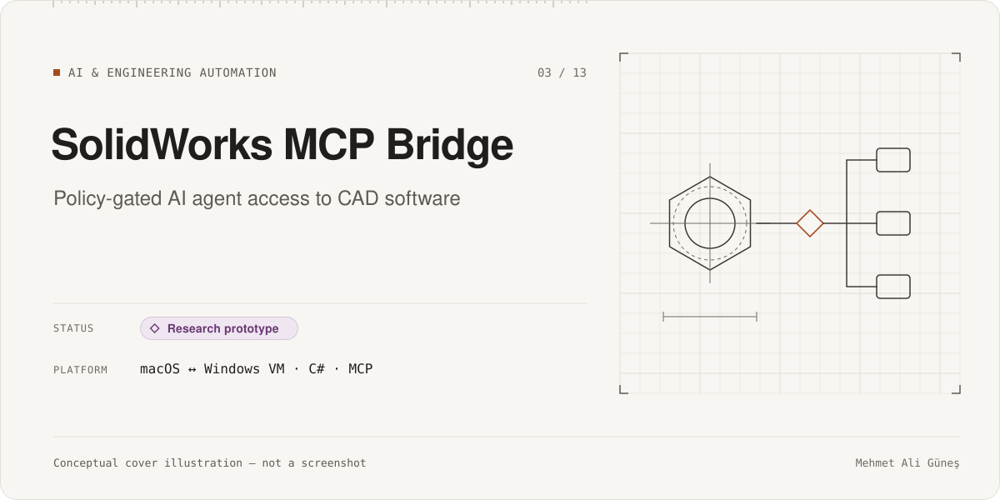
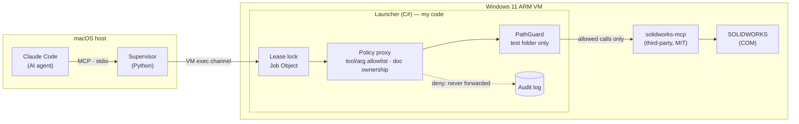

# SolidWorks MCP Bridge

**Category:** AI & Engineering Automation · **Platform:** macOS host ↔ Windows 11 ARM VM · **Period:** Nov 2026 · **Source code:** private

> A safety layer that lets an AI coding agent on a Mac drive SOLIDWORKS inside a Windows virtual machine. A default-deny policy proxy checks every tool call, argument, file path and document before it can reach the CAD system.

## Overview

SOLIDWORKS runs only on Windows. My development machine is an Apple-silicon Mac with a Windows 11 ARM virtual machine (Parallels), where SOLIDWORKS runs under x64 emulation.

This project connects Claude Code on the Mac to an **open-source SOLIDWORKS MCP server** (third-party) running inside the VM, and puts my own **policy proxy** in between. The goal was to find out whether an AI agent can create real, parametric CAD parts **without being able to touch anything else**: user documents, other open files, arbitrary paths, or macros.

This is a **research prototype**, built under an academic (student) SOLIDWORKS licence. It is not affiliated with Dassault Systèmes.

## Problem & Motivation

An MCP server for CAD typically exposes dozens of powerful tools: open or save any file, run VBA macros, change dimensions in any open document. An AI agent that is given all of them could:
- overwrite or close a user's unsaved work
- write outside a test folder, including through path tricks such as `..`, UNC paths, symbolic links or hard links
- run arbitrary macro code.

Prompt instructions alone are not a safety boundary. I wanted the boundary **in the byte stream between the agent and the server**, enforced regardless of what the model decides to do.

## Solution

The work followed gated phases: **feasibility → G0 environment → G1 build → G2 live test → G3 transport → G4 process safety → G5 write policy → G6 acceptance**. Each phase has a written report, and I approved each one before the next began.

- **Transport:**
  - A Python supervisor on the Mac speaks MCP over stdio to Claude Code.
  - It starts the Windows side through the virtualization CLI.
  - If the VM is suspended, the supervisor resumes it.
- **Process safety:**
  - A C# launcher on Windows holds a single-instance lease lock and runs the server inside a Windows Job Object, so stray processes die with it.
  - It detects a dead owner on the Mac side (by process ID plus start time), so a crashed session cannot leave a zombie server holding SOLIDWORKS.
- **Policy proxy** (C#, in the launcher), default-deny:
  - Only **21 allowlisted tools** are accepted (status, help, new/open/save/close document, sketch, extrude, dimension and model-info operations). Each tool has an allowlist of argument keys.
  - Unknown tools, unknown keys, other JSON-RPC methods, batches, malformed JSON and duplicate pending request IDs are rejected.
  - **Document ownership:** the agent can edit only documents it created in this session. Documents that were already open are "adopted" read-only, and the agent cannot activate them for editing.
  - **PathGuard:** writes are allowed only inside a dedicated test folder. Relative paths, `..`, UNC paths, reparse points and hard links are rejected. Files not listed in the manifest cannot be opened.
  - Bounded reads and bounded pending-request queues.
  - An audit log of every allow and deny decision.
  - A rejected call **never reaches the server**, so there is no CAD side effect.
- **Profiles:** a read-only profile and a test-write profile share one SOLIDWORKS lock, with an explicit switch between them.

## Key Features

### Implemented
- End-to-end MCP connection from Claude Code (macOS) to SOLIDWORKS 2026 inside the VM.
- Default-deny policy proxy with tool and argument allowlists, document ownership, a path guard and an audit log.
- Process lifecycle safety: lease lock, Job Object, owner-liveness detection, and cleanup of the session's own documents only.
- A live scenario through the bridge creates a fully parametric block part. It changes a dimension, rebuilds, verifies the volume, saves it, and reopens it to confirm the parameters persisted.
- A natural-language test through Claude Code **CLI**. The agent chose the tool sequence itself and corrected its own path after a policy denial. The result was checked independently afterwards.

### In progress
- The same natural-language test through the Claude Code **desktop app** (not done yet).

### Planned (not built)
- Wider tool coverage (assemblies, mates, revolve). These tools are deliberately denied today.
- Any non-academic use; the current licence does not allow it.

## Technologies

- **My components:** C# / .NET 10 (launcher, policy proxy, path guard, self-test); a Python supervisor and test harness (written with AI assistance); shell scripts for profile switching.
- **Protocols:** Model Context Protocol (JSON-RPC over stdio), Windows COM automation (through the upstream server).
- **Environment:** Parallels Desktop (Windows 11 ARM64), SOLIDWORKS 2026 under x64 emulation.

**Third-party components:**
- [`soheil-mp/solidworks-mcp`](https://github.com/soheil-mp/solidworks-mcp) (MIT): the MCP server that talks to SOLIDWORKS over COM. I built it from a pinned commit and did not modify it. Its 248 unit tests are the upstream project's tests; I only ran them as a build check.
- Other open-source SOLIDWORKS MCP projects were reviewed during the feasibility study. They were not used.

## System Architecture

*Conceptual architecture diagram.*

## My Role & Contributions

- Feasibility study: compared candidate servers, platform constraints (ARM VM, x64 emulation, COM in an interactive session) and transport options.
- Designed the security model: enforcement in the byte stream, default deny, document ownership, path rules and audit.
- Defined and approved the phase gates. Each phase has a report with its open risks.

**AI-assisted development:**
- The supervisor, launcher, policy proxy, tests and reports were written by AI coding agents under my direction.
- An independent AI reviewer (OpenAI Codex, read-only) reviewed the policy layer twice. Its findings were fixed and re-verified.
- See [AI-assisted development](../../docs/ai-assisted-development.md).

## Testing & Validation

| Test | Scope | Result | Label |
|---|---|---|---|
| Protocol-level policy tests | Allow/deny rules, malformed input, ID handling, path cases | 78 pass / 0 fail / 1 skip | RECORDED 2026-11-07 |
| Live denial tests against real SOLIDWORKS | Denied tools, cross-document edits, outside-folder / UNC / `..` / unlisted files | **33 / 33 pass** | RECORDED 2026-11-07 |
| Live parametric scenario | Create a block, change length, rebuild, check volume 32 000 → 38 400 mm³, save, reopen | **25 / 25 pass** | RECORDED 2026-11-07 |
| Independent review of the policy layer (2 rounds) | Correctness and security | PASS WITH ISSUES both rounds: no high or critical findings. All medium and low findings were fixed, but the last round of fixes has **not been re-reviewed** yet | RECORDED 2026-11-07 |
| Upstream build check | Upstream unit tests (not my tests) | 248 / 248 | RECORDED 2026-11-07 |

The denial tests were cross-checked three independent ways:
- the server's own operation log showed only the allowed calls
- the file hashes of existing parts were unchanged before and after
- the SOLIDWORKS process ID and open-document list were identical before and after.

These live tests need the VM and the licensed CAD software, so they were **not re-run** for this portfolio.

## Current Development Status

**Research prototype: accepted at G6.**
- The safety model works against real SOLIDWORKS, with recorded evidence.
- Open items and known limits, as recorded in the project:
  - the desktop-app natural-language test is still pending
  - the last review fixes have not been re-reviewed, and the shutdown time-out path has no automated test
  - junctions and hard links were tested, but symbolic links were not tested directly
  - after a hard disconnect, an orphaned server can remain until the next connection (accepted limit)
  - the upstream server has broad file access of its own; the write protection covers only calls that pass through the launcher
  - the status tool exposes the titles of open documents to the model provider.
- Academic licence only.

## Screenshots / Visuals

No application screenshots are shown. The bridge runs against licensed CAD software inside a virtual machine, and its window contents include local file names, so it cannot be captured safely for public use.

The **conceptual architecture** diagram in [System Architecture](#system-architecture) shows the design. It is not a screenshot.

Facts as of 2026-11-10. Evidence labels: RE-RUN, RECORDED, STATIC, CI. See [status legend](../../docs/status-legend.md). SOLIDWORKS is a trademark of Dassault Systèmes; this project is independent.
