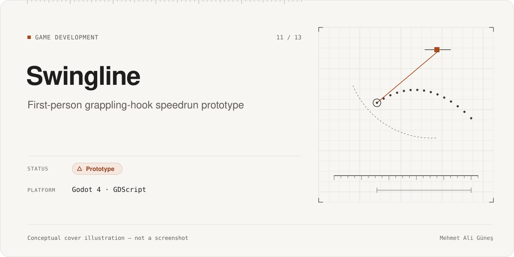
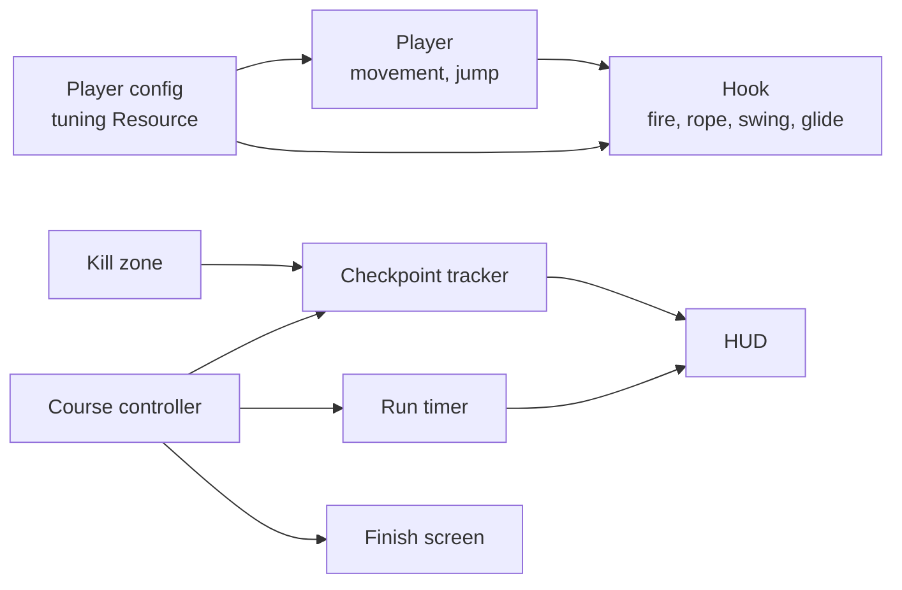

# Swingline

**Category:** Game Development · **Platform:** Godot 4 (desktop) · **Period:** Oct 2026 · **Source code:** private (not yet under version control)

> A first-person grappling-hook speedrun prototype: fire a hook, swing, release to glide, and clear five checkpoints against the clock. Built as a small, testable vertical slice in Godot.

## Overview

Swingline is a greybox game prototype. Its purpose was to test one mechanic, rope swinging with momentum carried into a glide, and to try a structured, agent-assisted game development workflow from game brief to stories to QA evidence.

## Problem & Motivation

Swing mechanics are easy to describe and hard to tune. Small changes to rope length, gravity or release speed change the whole feel. I wanted a minimal course where the mechanic could be implemented, tuned through data, and checked against written acceptance criteria. I also wanted to learn how far an AI-assisted studio workflow can take a small game.

## Solution

- A game brief and an epic with seven stories (movement, hook, swing physics, release and glide, test course, checkpoints, timer and finish) defined the scope.
- Tuning values live in a single Godot Resource, so feel can be adjusted without code changes.
- Each completed story has QA evidence: screenshots plus a written check.

## Key Features

### Implemented
- First-person movement and jump.
- Grappling hook: raycast fire, rope, swing physics, release and glide.
- Test course: platforms over a void, hookable slabs, a kill zone with respawn at the last checkpoint, and a finish zone.
- Five ordered checkpoints, a run timer, a HUD and a finish screen.

### In progress
- A developer playtest to tune the feel (pending).

### Planned (not built)
- Out of the prototype's scope: menus, multiple levels, audio, saving, gamepad support.

## Technologies

Godot 4.7 · GDScript (~725 lines, 13 scripts) · Jolt physics · Forward+ renderer

## System Architecture

*Conceptual architecture diagram.*

## My Role & Contributions

- Wrote the game brief and decided the core mechanic and the scope cuts.
- Set the story acceptance criteria and reviewed the QA evidence.
- Directed the tuning.

**AI-assisted development.** The game code and the planning documents were written by AI agents under my direction and review. The design decisions, the acceptance criteria and the evidence review were mine.

The game code has **not yet been committed to version control.** There is no authorship history to show for it.

**Third-party components**
- The project started from the **"Claude Code Game Studios" template v1.2.0 by Donchitos (MIT license)**. The template provides the agent and workflow structure and its own test suite. The template's files and git history are the template author's work, not mine.
- Godot Engine (MIT). No asset-store art or plugins; the visuals are primitive greybox shapes.

## Testing & Validation

- QA evidence for stories 003–005 (swing physics, release and glide, test course): screenshots and written checks (**RECORDED**, 2026-10-30; not re-run).
- In the story-005 evidence, a scripted bot completed the full course (**RECORDED**). A developer playtest is still pending.
- Stories 006–007 have screenshots only; story 001 has no written evidence file.
- There are **no automated game tests.** The template's own test suite tests the template, not this game.

## Current Development Status

**Prototype.** A playable greybox vertical slice. Not done: the developer playtest, tuning, art, audio, menus and version control for the game code.

## Screenshots / Visuals

Planned visuals: selected greybox QA screenshots (on-rope swing, course overview, finish screen), reviewed before publishing.

---
Facts as of 2026-11-10. Evidence labels: RE-RUN = re-executed on that date; RECORDED = taken from the project's own dated report, not re-run; STATIC = file/code count; CI = GitHub Actions record. See ../../docs/status-legend.md.
