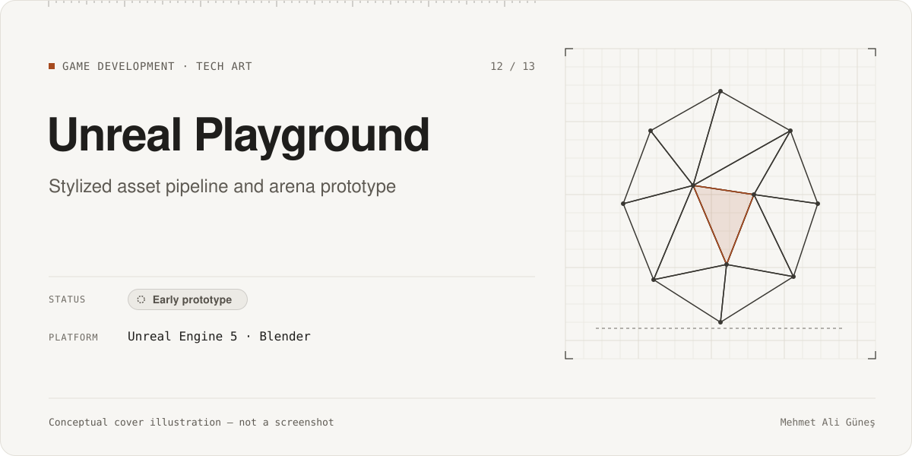
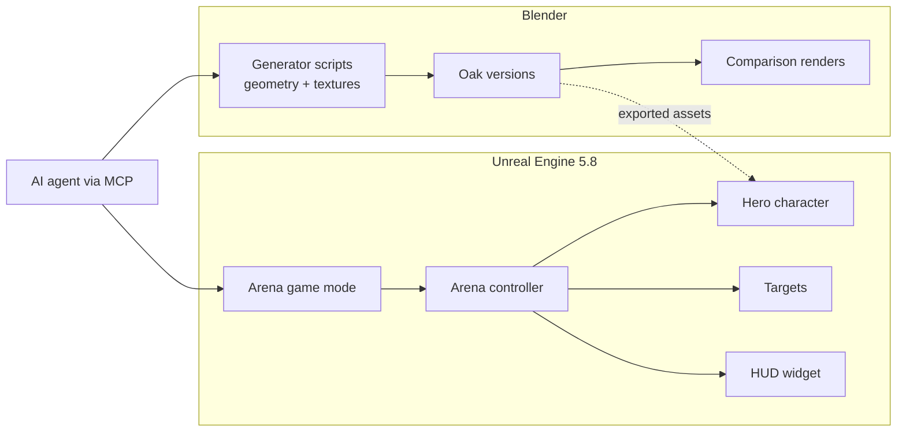

# Unreal Playground

**Category:** Game Development · Tech Art · **Platform:** Unreal Engine 5.8 (Blueprints) · Blender · **Period:** Oct 2026 · **Source code:** private

> A learning sandbox for driving Unreal Engine and Blender through AI agents over MCP. Its most developed part is a scripted Blender pipeline for a stylized tree asset; the Unreal arena itself is an early Blueprint prototype.

## Overview

This project explores a new kind of workflow: AI agents that work directly inside creative tools through the Model Context Protocol. On the Blender side, generator scripts build and texture a stylized oak tree in versions that can be compared with each other. On the Unreal side, a small arena level with a hero character, targets, a game mode and a HUD was set up in Blueprints.

## Problem & Motivation

I wanted to understand whether AI agents can do useful technical-art and level-setup work when connected to real editors, and where they need human direction. A small, low-stakes project was the right place to test this before using the approach on larger work.

## Solution

- **Blender pipeline:** generator scripts build the tree geometry and procedural textures; renders are produced for side-by-side version comparison.
- **Unreal prototype:** a separate arena level with its own Blueprint actors, stylized materials and simple sound effects, built on top of Unreal's Third Person template.

## Key Features

### Implemented
- Scripted Blender pipeline for a stylized oak asset: geometry and texture generators, several versions, and about 50 comparison renders.
- An Unreal arena level with Blueprint classes for the hero, the targets, the arena controller, the game mode and the HUD.
- About 25 stylized materials and a few hit/kill/shot sound effects.

### In progress
- Nothing recorded; the project stage is "Technical Setup".

### Planned (not built)
- Verified arena gameplay. There is no evidence yet that the arena loop works end to end.

## Technologies

Unreal Engine 5.8 (Blueprints, Enhanced Input, Lumen, Virtual Shadow Maps) · Unreal Engine MCP plugin · Blender with Blender MCP · Python generator scripts written with AI assistance

## System Architecture

*Conceptual architecture diagram.*

## My Role & Contributions

- Chose the experiment and its scope.
- Directed the agents' work in Blender and Unreal.
- Judged visual versions and decided which direction to keep.

**AI-assisted development.** Most assets, scripts and Blueprints were produced by AI agents working through Blender MCP and Unreal Engine MCP under my direction. I do not present the Python scripts as Python expertise.

**Third-party components**
- Unreal Engine 5.8 and Epic's **Third Person template content**, including the Mannequin characters and animations, under the Unreal Engine EULA. This content is not mine and is not redistributed.
- Epic's Unreal Engine MCP / toolset plugins.
- The **"Claude Code Game Studios" template (v1.2.0, Donchitos, MIT)** for the agent workflow structure.
- Blender (GPL).

## Testing & Validation

- **No automated tests** and no gameplay QA evidence exist.
- The Blender pipeline's output is evidenced by its version renders (**STATIC**, 2026-11-10).

## Current Development Status

**Early prototype.** The Blender asset pipeline is the most mature part. The Unreal arena has its building blocks, but no verified gameplay.

## Screenshots / Visuals

Planned visuals: selected oak comparison renders from my own pipeline. No Epic template or Mannequin content is shown.

---
Facts as of 2026-11-10. Evidence labels: RE-RUN = re-executed on that date; RECORDED = taken from the project's own dated report, not re-run; STATIC = file/code count; CI = GitHub Actions record. See ../../docs/status-legend.md.
